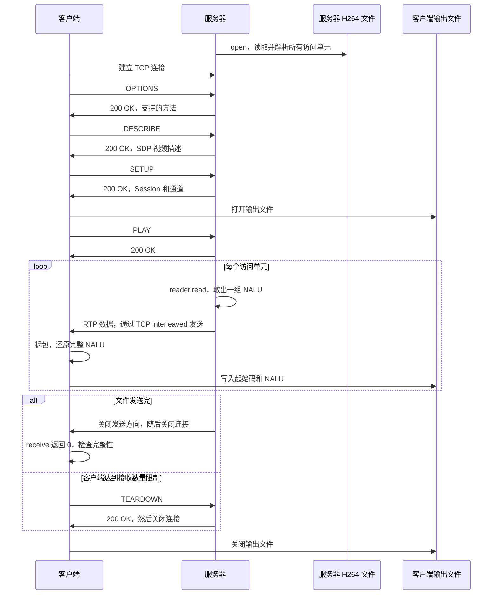

# RTSP 完整传输流程：从客户端请求到 H.264 文件保存

本文按照当前项目的实际实现，描述客户端建立连接、发送 RTSP 请求、服务器传输视频、客户端还原并写入文件，以及双方结束连接的完整过程。

示例环境：

```text
服务器地址：127.0.0.1:8554
请求地址：rtsp://127.0.0.1:8554/live
服务器输入文件：samples/sample.h264
客户端输出文件：received.h264
```

**客户端通过 RTSP 请求控制播放；服务器将 H.264 视频封装成 RTP 包发送。RTSP 消息和 RTP 数据共用同一条 TCP 连接。**

## 1. 整体时序



上图展示两个正常结束分支；主动 TEARDOWN 分支要求服务器当时仍能处理请求。如果服务器已因文件结束关闭连接，就无法再完成 TEARDOWN 交换。

## 2. 服务器先准备视频文件，再等待客户端连接

代码入口：[server_main.cpp](E:/MarkDown/rtsp-cpp/src/app/server_main.cpp)。

服务器首先执行：

```cpp
rtsp::H264FileReader reader;
reader.open(path);
```

`open()` 将整个输入文件读入内存，寻找 Annex-B 起始码，拆出 NALU，再根据 AUD 划分访问单元，保存到 `frames_`。

例如，解析结果可能是：

```text
frames_[0]：AUD、SPS、PPS、IDR
frames_[1]：AUD、普通图像 NALU
frames_[2]：AUD、普通图像 NALU
……
```

`H264AccessUnit` 表示一组 NALU；`H264FileReader` 内部保存多组 `H264AccessUnit`。本文沿用代码中的 `frame` 命名，将一个访问单元简称为“一帧”。当前实现依赖 AUD 分组，没有通过完整的 slice 解析推导帧边界。

服务器随后使用 SPS、PPS 生成 SDP 中的 H.264 参数：

```cpp
rtsp::SessionDescription description;
description.video.fmtp =
    rtsp::make_h264_fmtp(reader.sps(), reader.pps());
```

此时视频数据和描述信息已经准备好，但尚未向客户端发送视频。

接下来创建监听 socket，等待连接：

```cpp
rtsp::net::TcpSocket listener;
listener.listen(address, port);

rtsp::net::TcpSocket connection;
listener.accept_client(connection);
```

`listener` 负责监听；`connection` 持有接受连接后用于通信的 socket。本示例只处理一个客户端。

## 3. 客户端建立 TCP 连接

代码入口：[client_main.cpp](E:/MarkDown/rtsp-cpp/src/app/client_main.cpp)。

```cpp
rtsp::net::TcpSocket connection;
connection.connect(host, port);
```

成功后，两端拥有一条可以双向传输字节的 TCP 连接：

```text
客户端 connection ←──── TCP ────→ 服务器 connection
```

客户端继续执行：

```cpp
rtsp::RtspClient client(connection);
client.run(url, output_path, frame_limit);
```

`run()` 负责发送后续 RTSP 请求、接收视频和保存文件。TCP 连接成功后，还需要通过 RTSP 协商资源、传输方式和播放时机。

## 4. OPTIONS：查询服务器支持的方法

客户端流程主要位于 [rtsp_client.cpp](E:/MarkDown/rtsp-cpp/src/rtsp/rtsp_client.cpp)。

客户端构造请求：

```cpp
RtspMessage options;
options.method = "OPTIONS";
options.uri = url;
const RtspMessage options_response = exchange(options);
```

`exchange()` 添加 `CSeq`，将请求序列化并发送。请求大致如下；文中的报文示例省略不影响理解的字段，实际行结束符是 `\r\n`，头部之后还有空行：

```text
OPTIONS rtsp://127.0.0.1:8554/live RTSP/1.0
CSeq: 1

```

服务器返回：

```text
RTSP/1.0 200 OK
CSeq: 1
Public: OPTIONS, DESCRIBE, SETUP, PLAY, TEARDOWN

```

`Public` 告诉客户端服务器支持哪些方法；`CSeq: 1` 表示该响应对应第一个请求。

此时服务器仍为 `SessionInit`，尚未开始发送视频。

## 5. 每个 RTSP 请求如何经过两端代码

OPTIONS、DESCRIBE、SETUP、PLAY 和 TEARDOWN 基本都经过相同的请求与响应链路。

### 5.1 客户端发送请求

```text
构造 RtspMessage 请求
        ↓
exchange(request)
        ↓
添加 CSeq
        ↓
serialize_rtsp_message()
        ↓
connection_.send_all()
```

### 5.2 服务器接收请求并返回响应

```text
connection.receive()
        ↓
parser.append(buffer, count)
        ↓
parser.next(item)
        ↓
得到完整 RTSP 请求
        ↓
session.handle(request)
        ↓
得到响应对象
        ↓
serialize_rtsp_message()
        ↓
connection.send_all()
```

会话检查和状态切换位于 [rtsp_server_session.cpp](E:/MarkDown/rtsp-cpp/src/rtsp/rtsp_server_session.cpp)。

### 5.3 客户端接收响应

```text
connection_.receive()
        ↓
parser_.append(buffer, count)
        ↓
parser_.next(item)
        ↓
得到完整响应
        ↓
检查 CSeq 和状态码
        ↓
exchange() 返回响应
```

`exchange()` 会跳过 1xx 临时响应，等待最终响应；本项目要求最终状态码为 200，否则报错。等待响应时若收到 interleaved 媒体数据，也会交给媒体处理函数。

### 5.4 为什么需要解析器

TCP 提供连续字节流，一次 `receive()` 不一定刚好得到一条完整消息。例如：

```text
第一次 receive：半条 RTSP 响应
第二次 receive：剩余响应 + 下一个消息的一部分
```

也可能一次收到多个完整消息。

[RtspStreamParser](E:/MarkDown/rtsp-cpp/src/rtsp/rtsp_stream_parser.cpp) 通过 `append()` 保存字节，通过 `next()` 依次取出完整消息。数据不够时返回 false，保留已有内容，等待下一次追加。

## 6. DESCRIBE：获取视频描述

客户端发送：

```text
DESCRIBE rtsp://127.0.0.1:8554/live RTSP/1.0
CSeq: 2
Accept: application/sdp

```

意思是请求该资源的视频格式和轨道信息。

服务器返回 `200 OK`，设置 `Content-Type: application/sdp` 和 `Content-Base`，响应正文为 SDP。关键内容类似：

```text
a=control:*
m=video 0 RTP/AVP 96
a=rtpmap:96 H264/90000
a=fmtp:96 packetization-mode=1;profile-level-id=...;sprop-parameter-sets=...
a=control:trackID=0
```

| SDP 内容 | 含义 |
|---|---|
| `96` | 视频使用的 RTP Payload Type |
| `H264` | 视频编码为 H.264 |
| `90000` | RTP 时间戳每秒有 90000 个刻度 |
| `packetization-mode=1` | H.264 的 RTP 打包模式 |
| `profile-level-id` | 从 SPS 提取的配置、约束和级别信息 |
| `sprop-parameter-sets` | Base64 编码的 SPS、PPS |
| `trackID=0` | 视频轨道的控制地址 |

SDP 中的 `m=video 0` 不代表另开 UDP 端口 0；后续 SETUP 会协商使用现有 TCP 连接传输媒体。

客户端执行：

```cpp
description_ = parse_sdp(describe_response.body);
```

随后优先使用 `Content-Base`，其次使用 `Content-Location`，最后使用请求 URL 作为基地址，解析轨道控制地址和聚合控制地址。

本例得到：

```text
视频轨道地址：rtsp://127.0.0.1:8554/live/trackID=0
聚合控制地址：rtsp://127.0.0.1:8554/live/
```

服务器同时接受聚合路径 `/live` 和 `/live/`；本文请求示例统一使用 `/live`。SETUP 针对具体轨道，PLAY 和 TEARDOWN 针对聚合资源。

此时仍未开始发送视频。

## 7. SETUP：协商传输方式并建立会话

客户端针对视频轨道发送：

```text
SETUP rtsp://127.0.0.1:8554/live/trackID=0 RTSP/1.0
CSeq: 3
Transport: RTP/AVP/TCP;unicast;interleaved=0-1

```

含义如下：

```text
使用 TCP 传输 RTP
通道 0：RTP 视频数据
通道 1：RTCP 控制数据
```

**0 和 1 是同一条 TCP 连接中的通道编号，不是端口号。** 本项目协商 RTCP 通道，但没有实现完整的 RTCP 收发处理。

服务器检查轨道、状态和传输方式。通过后保存通道并切换状态：

```cpp
transport_ = requested_transport;
state_ = SessionReady;
```

响应示例：

```text
RTSP/1.0 200 OK
CSeq: 3
Transport: RTP/AVP/TCP;unicast;interleaved=0-1
Session: 12345678

```

`12345678` 仅为示意。当前服务器创建连接会话对象时，使用时间值构造数字 Session 标识；SETUP 成功后才将其返回客户端。

客户端保存响应中的值：

```cpp
session_id_ = session_id;
transport_ = negotiated;
```

客户端采用服务器实际确认的通道编号，不能假定始终是 0/1。后续 PLAY 和 TEARDOWN 必须携带 Session。

服务器状态变化：

```text
SessionInit → SessionReady
```

此时传输方式准备完成，等待开始播放。

## 8. PLAY：开始发送视频

客户端先打开输出文件：

```cpp
writer_.open(output_path);
```

这样在请求开始播放前，`received.h264` 就已准备好接收数据。当前打开模式会截断已有同名文件。

然后发送：

```text
PLAY rtsp://127.0.0.1:8554/live RTSP/1.0
CSeq: 4
Session: 12345678

```

服务器检查 Session、请求地址和当前状态，成功后：

```cpp
state_ = SessionPlaying;
```

返回：

```text
RTSP/1.0 200 OK
CSeq: 4
Session: 12345678

```

服务器发送响应后设置：

```cpp
next_send = std::chrono::steady_clock::now();
```

客户端收到成功响应，进入：

```cpp
receive_media(frame_limit);
```

此时服务器持续发送，客户端持续接收。**客户端无需每帧发送一次请求；一次 PLAY 成功后，服务器就会连续推送视频。**

## 9. 服务器如何同时处理请求和定时发送

服务器播放阶段的主循环可以简化为：

```cpp
if (session.state() == rtsp::SessionPlaying) {
    // 计算距离下一帧发送时间还需要等待多久。
    if (!connection.wait_readable(wait_ms)) {
        // 等待超时，没有客户端数据：取一帧并发送。
        // 更新发送时间和 RTP 时间戳。
        continue;
    }
}

const std::size_t count =
    connection.receive(buffer, sizeof(buffer));
```

实际执行分支：

```text
等待下一帧发送时间
        │
        ├─ 连接可读
        │      ↓
        │  receive() 接收客户端请求，或获知对端关闭
        │      ↓
        │  例如处理 TEARDOWN
        │
        └─ 等待超时，未变为可读
               ↓
           reader.read() 取出一帧
               ↓
           send_frame() 发送
               ↓
           continue，进入下一轮循环
```

因此，服务器这里的 `connection.receive()` 主要接收客户端的 RTSP 请求，不是读取服务器上的 H.264 文件。它也可能收到协商通道上的 interleaved 数据，当前服务器验证通道后忽略这些数据。

成功发送一帧后会执行 `continue`，不会紧接着执行下面的 `receive()`。如果 `reader.read()` 发现文件已发完，则退出循环。

`steady_clock` 是单调时钟，用于安排发送间隔；RTP timestamp 是媒体时间，两者用途不同。

## 10. 服务器取出访问单元并打包发送

服务器取一帧：

```cpp
rtsp::H264AccessUnit frame;
reader.read(frame);
```

这里的 `read()` 从内存中的 `frames_` 复制下一组数据，不是再次从磁盘读取文件。

假设第一帧包含：

```text
frame.nalus：
    AUD
    SPS
    PPS
    一个较大的 IDR NALU
```

服务器调用：

```cpp
send_frame(connection, frame, session.transport(),
           description.video.payload_type, sequence, timestamp);
```

函数按 NALU 顺序，再按分片顺序发送：

```text
一个完整 NALU（包含 NALU 头，不包含 Annex-B 起始码）
        ↓
H264Packetizer::packetize()
        ↓
一个或多个 RTP payload
        ↓
为每个 payload 添加 RTP 头
        ↓
添加 TCP interleaved 头
        ↓
connection.send_all()
```

小 NALU 可以直接放进一个 RTP 包。大 NALU 使用 FU-A 拆成多个 payload，接收端之后再将它们拼回完整 NALU。当前发送端不生成 STAP-A 聚合包。

### 10.1 RTP 字段示例

当前服务器初始值为：

```cpp
std::uint16_t sequence = 100;
std::uint32_t timestamp = 0;
// send_frame 中固定使用 SSRC 12345。
```

假设 IDR 拆成 3 个包：

| 内容 | sequence | timestamp | marker |
|---|---:|---:|---:|
| AUD | 100 | 0 | 0 |
| SPS | 101 | 0 | 0 |
| PPS | 102 | 0 | 0 |
| IDR 第一个分片 | 103 | 0 | 0 |
| IDR 中间分片 | 104 | 0 | 0 |
| IDR 最后一个分片 | 105 | 0 | 1 |

- 每发一个 RTP 包，sequence 加 1，达到 16 位上限后回绕。
- 同一访问单元中的所有 RTP 包使用相同的 timestamp。
- 只有访问单元中最后一个 NALU 的最后一个包，marker 才为 1。
- FU-A 的结束标志表示一个 NALU 结束；RTP marker 表示整个访问单元结束，两者含义不同。

### 10.2 实际 TCP 数据结构

```text
┌──────────────────────┬──────────┬────────────────┐
│ interleaved 头 4 字节 │ RTP 头   │ H264 payload   │
└──────────────────────┴──────────┴────────────────┘
```

interleaved 头：

```text
'$' + 1 字节通道编号 + 2 字节长度
```

长度采用网络字节序，表示后面整个 RTP 包的字节数，不包含 interleaved 头本身。

### 10.3 帧间隔和媒体时间戳

发送一帧后：

```cpp
timestamp += 3600;
next_send += std::chrono::milliseconds(40);
```

当前项目固定按照每秒 25 个访问单元安排发送：

```text
每帧间隔：1000 / 25 = 40 ms
RTP 时间戳增量：90000 / 25 = 3600

第 1 帧 timestamp = 0
第 2 帧 timestamp = 3600
第 3 帧 timestamp = 7200
……
```

这属于固定节奏调度，不是从文件提取真实 PTS/DTS。实际发送时刻还会受到系统调度和网络发送耗时影响。

## 11. 客户端接收字节，拆出 RTP 包

`receive_media()` 循环接收 TCP 数据：

```cpp
const std::size_t count =
    connection_.receive(buffer, sizeof(buffer));

parser_.append(buffer, count);
```

然后取出完整消息：

```cpp
while (parser_.next(item)) {
    handle_interleaved(item);
}
```

解析器发现当前消息起点是 `$`，就按 interleaved 格式处理：

```text
读取通道编号
        ↓
读取长度
        ↓
等待指定长度的数据收齐
        ↓
取出完整 RTP 包，放入 item.payload
```

解析器只检查当前消息起点，不会在二进制 payload 内任意搜索 `$`。

`handle_interleaved()` 先检查通道：RTCP 通道直接忽略，未协商的通道报错，RTP 通道继续处理。

随后解析 RTP：

```cpp
const RtpPacket packet = parse_rtp_packet(item.payload);
```

得到 Payload Type、sequence、timestamp、SSRC、marker 和 payload。

客户端检查：

- Payload Type 是否与 SDP 一致。
- 从第二个 RTP 包起，sequence 是否连续。
- SSRC 是否与第一个包一致。

检查通过后，再将 RTP 包交给 H.264 解包器。

## 12. 客户端还原 NALU，并写入输出文件

客户端调用：

```cpp
std::vector<std::string> nalus;
const H264DepacketizeResult result = depacketizer_.push(packet, nalus);
```

### 12.1 一个 RTP 包包含完整 NALU

```text
收到 RTP 包
        ↓
取出完整 NALU
        ↓
放入 nalus
        ↓
writer_.write(nalu)
```

### 12.2 一个 NALU 被拆成多个 FU-A 包

```text
收到开始分片 → 恢复 NALU 头，保存第一部分
收到中间分片 → 继续追加数据
收到结束分片 → 得到完整 NALU
                         ↓
                   writer_.write(nalu)
```

分片尚未收齐时，不会将这个残缺 NALU 写入文件。解包器也会检查分片的序号、时间戳及其他一致性信息。客户端发现解包结果为 `H264Dropped` 时会报错。

接收端还支持解析 STAP-A，一个这样的 RTP 包可以输出多个完整 NALU；本项目发送端不使用这种打包方式。

### 12.3 写成 Annex-B 格式

[H264FileWriter](E:/MarkDown/rtsp-cpp/src/media/h264_file_writer.cpp) 为每个完整 NALU 写入四字节起始码，再写入 NALU 内容：

```cpp
output_.write("\0\0\0\1", 4);
output_.write(nalu.data(), static_cast<std::streamsize>(nalu.size()));
```

输出文件逐步形成：

```text
00 00 00 01 + AUD
00 00 00 01 + SPS
00 00 00 01 + PPS
00 00 00 01 + IDR
00 00 00 01 + 下一帧 AUD
00 00 00 01 + 下一帧图像 NALU
……
```

文件中不保存 RTP 头和 interleaved 头。客户端每还原出一个完整 NALU 就写入，不需要重新构造 `H264AccessUnit` 对象，也没有对视频进行解码或显示。

由于输出统一使用四字节起始码，而输入可能混用三字节、四字节起始码，并且读取时会处理尾部零字节，所以输出不保证与输入文件逐字节相同。

### 12.4 判断一帧结束

处理完一个 RTP 包后：

```cpp
frame_complete_ = packet.marker;
if (packet.marker) {
    depacketizer_.finish();
    ++received_frames_;
}
```

marker 为 1 表示当前访问单元结束。此时检查是否有尚未完成的 FU-A NALU，并增加已接收访问单元数量。

## 13. 结束方式一：服务器发送完整个文件

默认 `frame_limit = 0` 时，客户端持续接收直到 EOF。

服务器再次取帧时：

```cpp
if (!reader.read(frame)) {
    connection.shutdown_send();
    break;
}
```

`read()` 返回 false 表示内存中的访问单元已经全部取完。服务器关闭发送方向、退出循环，随后关闭通信 socket 和监听 socket。

客户端先读完此前已发送的数据，再次接收时得到：

```cpp
count == 0
```

这表示对端已经结束发送，不是暂时没有新数据。

客户端执行：

```cpp
parser_.finish();
depacketizer_.finish();
```

并确认至少收到过 RTP 数据，且最后停在一个完整访问单元的边界上：

```cpp
if (!received_packet_ || !frame_complete_) {
    throw std::runtime_error("stream ended before a complete H264 access unit");
}
```

检查通过后：

```text
receive_media() 返回
        ↓
writer_.close()
        ↓
client.run() 返回
        ↓
connection.close()
        ↓
客户端退出
```

**默认自然结束分支不再发送 TEARDOWN，也没有单独的“播放结束”RTSP 消息，而是通过 TCP EOF 表示结束。**

## 14. 结束方式二：客户端达到接收限制，主动 TEARDOWN

假设客户端设置：

```text
frame_limit = 100
```

每处理一个 RTP 包后，客户端检查：

```cpp
if (frame_limit != 0 && received_frames_ >= frame_limit && frame_complete_) {
    return;
}
```

达到限制并位于完整帧边界时，`receive_media()` 返回，`run()` 发起：

```text
TEARDOWN rtsp://127.0.0.1:8554/live RTSP/1.0
CSeq: 5
Session: 12345678

```

如果服务器仍在播放循环中，`wait_readable()` 发现连接可读，于是执行：

```cpp
connection.receive(buffer, sizeof(buffer));
```

这次接收的是客户端的 TEARDOWN 请求。

服务器解析并交给状态机后：

```cpp
state_ = SessionClosed;
```

随后发送：

```text
RTSP/1.0 200 OK
CSeq: 5
Session: 12345678

```

服务器确认响应已经发送后退出主循环，关闭连接和监听 socket。客户端收到响应，校验 Session，再关闭输出文件和 TCP 连接。

### 14.1 为什么最终可能多保存几帧

发送 TEARDOWN 时，服务器此前发送的视频可能还在网络或客户端缓冲区中。客户端的 `exchange()` 在等待响应期间仍然处理 interleaved 数据，因此最终保存数量可能略多于 `frame_limit`。

### 14.2 如果服务器已经结束发送

当前代码在 `frame_limit != 0 && received_frames_ >= frame_limit` 时尝试 TEARDOWN。如果此时服务器已经因为文件发送完毕而关闭连接，请求交换可能失败。以上正常主动结束链路以服务器仍能响应请求为前提。

## 15. 三种“读取”分别读取什么

| 代码 | 数据来源 | 发生时间 |
|---|---|---|
| `H264FileReader::open()` 内的 `input.read()` | 磁盘中的 H.264 文件 | 服务器启动时 |
| `H264FileReader::read(frame)` | 内存中的 `frames_` | 服务器每次准备发送一帧时 |
| 服务器 `connection.receive()` | 客户端经 TCP 发送的数据，主要是 RTSP 请求 | 握手阶段及播放期间处理控制请求时 |
| 客户端 `connection_.receive()` | 服务器经 TCP 发送的数据，包括 RTSP 响应和 interleaved 媒体 | 等待响应和接收视频时 |

服务器已将输入文件读取到内存，并不意味着不再需要 `receive()`；磁盘读取和网络接收是两条不同的数据路径。

## 16. 状态机与关键函数索引

正常主动停止时的服务器状态变化：

```text
SessionInit
    │ OPTIONS / DESCRIBE：保持初始状态
    │ SETUP 成功
    ↓
SessionReady
    │ PLAY 成功
    ↓
SessionPlaying
    │ TEARDOWN 成功
    ↓
SessionClosed
```

自然 EOF 分支直接退出主循环并关闭连接，不需要先将状态切换为 `SessionClosed`。

### 控制请求链路

```text
RtspClient::run()
 → exchange()
 → serialize_rtsp_message()
 → TCP
 → 服务器 receive / RtspStreamParser
 → RtspServerSession::handle()
 → serialize_rtsp_message()
 → TCP 响应
 → 客户端 RtspStreamParser
 → exchange() 返回
```

### 视频数据链路

```text
H264FileReader::open()：磁盘文件 → 内存中的访问单元
 → H264FileReader::read()：取出下一访问单元
 → send_frame()
 → H264Packetizer::packetize()
 → serialize_rtp_packet()
 → serialize_interleaved_frame()
 → TCP
 → RtspClient::receive_media()
 → RtspStreamParser::next()
 → RtspClient::handle_interleaved()
 → parse_rtp_packet()
 → H264Depacketizer::push()
 → H264FileWriter::write()
 → received.h264
```

### 推荐对照阅读的源文件

| 源文件 | 重点 |
|---|---|
| [server_main.cpp](E:/MarkDown/rtsp-cpp/src/app/server_main.cpp) | 启动、请求处理循环、发送调度、`send_frame()` 和结束连接 |
| [client_main.cpp](E:/MarkDown/rtsp-cpp/src/app/client_main.cpp) | 建立连接并调用客户端流程 |
| [rtsp_client.cpp](E:/MarkDown/rtsp-cpp/src/rtsp/rtsp_client.cpp) | `run()`、`exchange()`、`receive_media()`、`handle_interleaved()` |
| [rtsp_server_session.cpp](E:/MarkDown/rtsp-cpp/src/rtsp/rtsp_server_session.cpp) | 请求合法性检查、响应生成和状态切换 |
| [rtsp_stream_parser.cpp](E:/MarkDown/rtsp-cpp/src/rtsp/rtsp_stream_parser.cpp) | 从 TCP 字节流拆出 RTSP 消息或 interleaved 数据 |
| [session_description.cpp](E:/MarkDown/rtsp-cpp/src/sdp/session_description.cpp) | SDP 生成、解析与控制地址处理 |
| [h264_file_reader.cpp](E:/MarkDown/rtsp-cpp/src/media/h264_file_reader.cpp) | Annex-B 文件解析和访问单元读取 |
| [h264_packetizer.cpp](E:/MarkDown/rtsp-cpp/src/media/h264_packetizer.cpp) | NALU 到 RTP payload 的打包 |
| [rtp_packet.cpp](E:/MarkDown/rtsp-cpp/src/rtp/rtp_packet.cpp) | RTP 头与 payload 的序列化、解析 |
| [h264_depacketizer.cpp](E:/MarkDown/rtsp-cpp/src/media/h264_depacketizer.cpp) | 从单 NALU、STAP-A、FU-A payload 还原完整 NALU |
| [h264_file_writer.cpp](E:/MarkDown/rtsp-cpp/src/media/h264_file_writer.cpp) | 为 NALU 添加起始码并写入输出文件 |
| [tcp_socket.cpp](E:/MarkDown/rtsp-cpp/src/net/tcp_socket.cpp) | TCP 连接、发送、接收、可读等待及关闭 |
