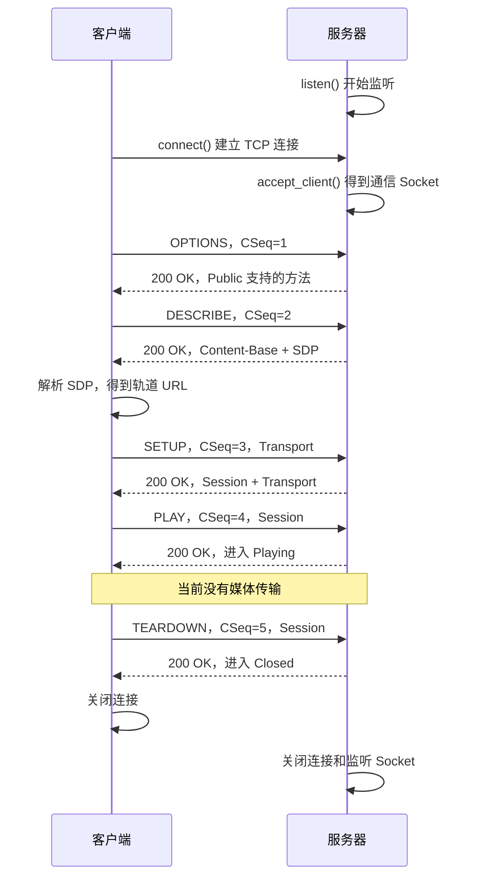

# 你看一下这个项目，现在我要你从服务器和客户端这个链路，完整的给我讲一下实现路径，用到了什么函数，每个函数的作用是什么

> 你看一下这个项目，现在我要你从服务器和客户端这个链路，完整的给我讲一下实现路径，用到了什么函数，每个函数的作用是什么

<details><summary>6 previous messages</summary>

> 我先梳理项目里服务器、客户端的入口和调用关系，再沿着连接建立、RTSP 交互、媒体传输到播放这条链路说明关键函数及其作用。我会先读取项目说明和相关源码。
>
> <details><summary>Ran 4 commands</summary>
>
> <details><summary>Explored a file</summary>
>
> - Read `C:/Users/Administrator/.agents/skills/obra-superpowers-using-superpowers/SKILL.md`
>
> </details>
>
> - Ran `Get-Location; rg --files -g AGENTS.md -g README* -g CMakeLists.txt -g '*.cpp' -g '*.h' -g '*.hpp' -g '*.c' -g '*.pro' -g '*.md'`
>
> - Ran `Get-Content -LiteralPath 'C:\Users\Administrator\.agents\skills\obra-superpowers-using-superpowers\references\codex-tools.md'; Get-Content -LiteralPath 'README.md'; Get-Content -LiteralPath 'CMakeLists.txt'`
>
> - Ran `Get-Content -LiteralPath 'src\rtsp\rtsp_server_session.h'; Get-Content -LiteralPath 'src\rtsp\rtsp_server_session.cpp'; Get-Content -LiteralPath 'src\rtsp\rtsp_client.h'; Get-Content -LiteralPath 'src\rtsp\rtsp_client.cpp'`
>
> - Ran `rg --files -g AGENTS.md 'E:\MarkDown'; Get-Content -LiteralPath 'src\app\server_main.cpp'; Get-Content -LiteralPath 'src\app\client_main.cpp'; Get-Content -LiteralPath 'src\app\command_line.h'`
>
> </details>
>
> 我按 using-superpowers 技能检查了本次阅读流程。源码和 README 都表明：当前项目已实现完整的 RTSP 控制链路，PLAY 成功后会立即 TEARDOWN；RTP 视频传输、解码和播放还没有实现。接下来我会把两端的调用链与底层拆包逻辑对应起来，明确每一步实际执行了哪些函数。
>
> <details><summary>Explored a file, ran 5 commands</summary>
>
> - Ran `Get-Content -LiteralPath 'src\rtsp\rtsp_session_utils.h'; Get-Content -LiteralPath 'src\rtsp\rtsp_session_utils.cpp'`
>
> - Ran `Get-Content -LiteralPath 'src\app\server_main.cpp'; Get-Content -LiteralPath 'src\rtsp\rtsp_message.h'; Get-Content -LiteralPath 'src\rtsp\rtsp_stream_parser.h'; Get-Content -LiteralPath 'src\rtsp\rtsp_stream_parser.cpp'`
>
> - Ran `Get-Content -LiteralPath 'E:\AGENTS.md','E:\MarkDown\AGENTS.md','E:\MarkDown\rtsp-cpp\AGENTS.md' -ErrorAction SilentlyContinue; Get-Content -LiteralPath 'CMakeLists.txt'; Get-Content -LiteralPath 'src\sdp\session_description.h'; Get-Content -LiteralPath 'src\sdp\session_description.cpp'`
>
> - Ran `Get-Content -LiteralPath 'src\net\tcp_socket.h'; Get-Content -LiteralPath 'src\net\tcp_socket.cpp'; Get-Content -LiteralPath 'src\net\socket_utils.h'; Get-Content -LiteralPath 'src\net\socket_utils.cpp'`
>
> <details><summary>Explored a file</summary>
>
> - Read `./src/rtsp/rtsp_message.cpp`
>
> </details>
>
> - Ran `rg -n '^(int main|inline .*parse_port|[A-Za-z_][A-Za-z_0-9:<> &*]*\([^;]*\).*(\{|$)|    (WinsockRuntime|~WinsockRuntime)\()' src; rg -n '^(void test_|bool test_|int main)|PLAY|interleaved|Content-Base|Content-Location|CSeq' tests\session_tests.cpp; rg --files -g '!build/**' -g '!build-*/**' -g '!**/.git/**'; git status --short`
>
> </details>
>
> 两端的主链路已经对上了：客户端由 `RtspClient::run()` 组织五次请求，`exchange()` 负责每次发送和等待响应；服务器入口负责收发字节，`RtspServerSession::handle()` 负责检查请求、生成响应和切换状态。两端共用同一套 RTSP 消息解析和流缓冲逻辑。我也核对了 SDP 如何生成轨道 URL，以及 Session、CSeq、交织通道各自在哪里保存和校验。
>
> <details><summary>Ran 2 commands</summary>
>
> - Ran `Get-Content -LiteralPath 'tests\rtsp_tests.cpp' | Select-Object -Last 32; Get-Content -LiteralPath 'tests\tcp_tests.cpp' | Select-Object -Last 32`
> - Ran `rg -n 'parse_rtsp_message|options.method|describe.method|description_ =|std::string base|track_url =|aggregate_url =|setup.method|session_id_ =|play.method|teardown.method|parser_.next|connection_.receive|parser_.append|listen\(address|accept_client|RtspServerSession session|connection.receive|parser.append|parser.next|session.handle|serialize_rtsp_message|connection.send_all|connection.close|listener.close|connection.connect|client.run' src; Get-Content -LiteralPath 'tests\session_tests.cpp' | Select-Object -Skip 140 -First 94`
>
> </details>
</details>

我把两个入口、网络层、RTSP 解析、SDP 和会话处理都看了一遍。**当前项目已经打通“客户端连接服务器 → 协商媒体信息和传输通道 → PLAY → TEARDOWN”的完整控制链路。**

但要先明确：**目前 PLAY 只是让服务器进入 `Playing` 状态，没有读取视频文件、发送 RTP、解码或显示画面。客户端收到 PLAY 成功响应后，立即发送 TEARDOWN。**

下面按照实际执行顺序，把两端如何配合、调用哪些函数、每个函数负责什么串起来。

**一、先看整个链路**

项目有两个独立程序：

| 程序 | 入口 | 职责 |
|---|---|---|
| 服务器 `rtsp_server` | [server_main.cpp](./src/app/server_main.cpp:22) | 监听连接、接收请求、调用会话状态机、发送响应 |
| 客户端 `rtsp_client` | [client_main.cpp](./src/app/client_main.cpp:19) | 建立连接、依次发送五种请求、解析响应、保存协商结果 |

两端共同使用 `rtsp_core`，里面包含 TCP、RTSP 消息、流解析和 SDP 模块。

实际交互顺序如下：



这里有四个容易混淆的数据：

| 数据 | 解决的问题 | 本项目示例 |
|---|---|---|
| TCP 连接 | 字节通过哪条网络连接传输？ | 客户端连接 `127.0.0.1:8554` |
| `CSeq` | 这个响应对应哪一个请求？ | `1、2、3、4、5` |
| `Session` | 这个请求操作哪个 RTSP 会话？ | 服务器生成的数字字符串 |
| interleaved 通道号 | 同一 TCP 连接里的二进制帧属于 RTP 还是 RTCP？ | `0/1` |

**二、第一步：服务器启动，等待客户端**

代码在 [server_main.cpp](./src/app/server_main.cpp:22)。

服务器 `main()` 的主流程可以简化为：

```cpp
解析命令行参数

TcpSocket listener;
listener.listen(address, port);

TcpSocket connection;
listener.accept_client(connection);

RtspServerSession session(...);
RtspStreamParser parser;

循环接收和处理请求

connection.close();
listener.close();
```

各个函数的作用如下。

**1. `parse_port()`：检查命令行端口**

实现位于 [command_line.h](./src/app/command_line.h:10)。

例如把字符串 `"8554"` 转成整数端口。

它会逐位读取数字，拒绝：

- 空字符串。
- 非数字字符。
- `0`。
- 大于 `65535` 的值。

客户端和服务器都使用这个函数。两个入口里的 `print_usage()` 则负责打印命令行用法。

**2. `TcpSocket::listen()`：创建监听 Socket**

实现位于 [tcp_socket.cpp](./src/net/tcp_socket.cpp:43)。

内部调用顺序是：

```text
initialize_sockets()
    ↓
构造 sockaddr_in
    ↓
::socket()
    ↓
::bind()
    ↓
::listen()
```

注意：项目的 `TcpSocket::listen()` 是一个封装函数，内部还会调用 Windows 提供的 `::listen()`。

| 函数 | 作用 |
|---|---|
| `initialize_sockets()` | 初始化 Windows 网络运行环境 |
| `htons(port)` | 把端口转成网络字节序 |
| `InetPtonA()` | 把 `"127.0.0.1"` 转成二进制 IPv4 地址 |
| `::socket()` | 创建一个 TCP Socket，取得句柄 |
| `::bind()` | 把 Socket 绑定到本地 IP 和端口 |
| `::listen()` | 将 Socket 设为监听状态 |

**调用结束后，服务器开始监听，但还没有拿到用于业务通信的客户端连接。**

**3. `TcpSocket::local_port()`：查询实际绑定端口**

内部调用 `getsockname()`，再用 `ntohs()` 转成本机字节序。

服务器用它打印监听端口。测试中如果传入端口 `0`，系统会自动分配端口，这个函数就能取得实际值。

**4. `TcpSocket::accept_client(connection)`：接受连接**

实现位于 [tcp_socket.cpp](./src/net/tcp_socket.cpp:78)。

它会阻塞等待客户端，内部调用：

```cpp
client.handle_ = ::accept(handle_, nullptr, nullptr);
```

这里必须理解两个对象的分工：

```text
listener
    持有监听句柄，负责接受连接

connection
    持有 accept 返回的新句柄，负责和这个客户端收发数据
```

`accept()` 成功后，原来的监听句柄仍然存在。

当前服务器只调用一次 `accept_client()`，因此只服务一个客户端；该会话结束后，整个服务器程序退出。

**三、第二步：客户端建立 TCP 连接**

代码在 [client_main.cpp](./src/app/client_main.cpp:19)。

主要调用：

```cpp
TcpSocket connection;
connection.connect(host, port);

std::string url = "rtsp://" + host + ":" + ... + "/live";

RtspClient client(connection);
client.run(url);

connection.close();
```

**1. `TcpSocket::connect()`：连接服务器**

实现位于 [tcp_socket.cpp](./src/net/tcp_socket.cpp:11)。

内部流程：

```text
检查对象尚未持有 Socket、端口不为 0
    ↓
initialize_sockets()
    ↓
htons() + InetPtonA()
    ↓
::socket()
    ↓
::connect()
```

`::connect()` 负责请求建立 TCP 连接，TCP 握手由操作系统处理。

成功后：

- 客户端的 `connection` 可以收发字节。
- 服务器的 `accept_client()` 可以返回。
- 后续五次 RTSP 请求都使用这同一条连接。

目前地址只支持数字 IPv4，例如 `127.0.0.1`，没有 DNS 主机名解析。

**2. `RtspClient::RtspClient(connection)`：保存 Socket 引用**

实现位于 [rtsp_client.cpp](./src/rtsp/rtsp_client.cpp:8)。

构造函数只是：

```cpp
RtspClient::RtspClient(net::TcpSocket& connection)
    : connection_(connection) {}
```

它借用入口创建的 Socket，不创建新连接，也不负责管理 Socket 的生命周期。

**3. `RtspClient::run(url)`：组织整个控制流程**

实现位于 [rtsp_client.cpp](./src/rtsp/rtsp_client.cpp:64)。

这个函数依次完成：

```text
OPTIONS
    ↓
DESCRIBE
    ↓
解析 SDP、计算 URL
    ↓
SETUP
    ↓
保存 Session 和通道
    ↓
PLAY
    ↓
TEARDOWN
```

它负责决定“发什么请求、拿响应做什么”，具体收发统一交给 `exchange()`。

**四、先拆开看：一次请求和响应如何走完整条链路**

五种请求都遵循同一个公共路径：

```text
客户端创建 RtspMessage
    ↓
RtspClient::exchange()
    ↓
serialize_rtsp_message()：对象转字节
    ↓
TcpSocket::send_all()
    ↓
TCP
    ↓
服务器 TcpSocket::receive()
    ↓
RtspStreamParser::append()
    ↓
RtspStreamParser::next()
    ↓
parse_rtsp_message()：字节转对象
    ↓
RtspServerSession::handle()
    ↓
生成响应 RtspMessage
    ↓
serialize_rtsp_message()
    ↓
TcpSocket::send_all()
    ↓
TCP
    ↓
客户端 receive → append → next
    ↓
exchange() 校验响应并返回
```

这里分成四层，边界很清楚：

| 层次 | 主要模块 | 负责什么 |
|---|---|---|
| 网络层 | `TcpSocket` | 连接、收字节、发字节 |
| 消息层 | `RtspMessage`、解析/序列化函数 | RTSP 文本格式与 C++ 对象互转 |
| 流拆分层 | `RtspStreamParser` | 处理半包、粘包和交织帧 |
| 会话层 | `RtspClient`、`RtspServerSession` | 请求顺序、参数协商和状态变化 |

下面把公共路径上的函数说明白。

**1. `RtspMessage`：请求和响应的数据容器**

定义位于 [rtsp_message.h](./src/rtsp/rtsp_message.h:22)。

请求主要使用：

```cpp
is_request = true;
method = "OPTIONS";
uri = "rtsp://127.0.0.1:8554/live";
```

响应主要使用：

```cpp
is_request = false;
status_code = 200;
reason = "OK";
```

两者共用：

```cpp
headers;  // 头字段
body;     // 消息体
```

它有两个成员函数：

| 函数 | 作用 |
|---|---|
| `header(name)` | 查找头字段，字段名不区分大小写；找不到返回空字符串 |
| `set_header(name, value)` | 已存在则更新，不存在则追加；字段名不区分大小写 |

例如：

```cpp
request.set_header("CSeq", "1");
response.header("Session");
```

**2. `RtspClient::exchange(request)`：完成一次请求—响应**

实现位于 [rtsp_client.cpp](./src/rtsp/rtsp_client.cpp:10)。

它的工作分为发送和等待响应两部分。

发送阶段：

```text
读取 next_cseq_
    ↓
next_cseq_ 加 1
    ↓
写入 CSeq
    ↓
序列化
    ↓
完整发送
```

等待响应阶段：

```text
先尝试解析已有缓冲
    ↓
没有完整消息，再 receive()
    ↓
append() 追加收到的字节
    ↓
再次解析
```

取到一条 RTSP 响应后，会检查：

- 收到的确实是响应，不是请求。
- 响应 `CSeq` 与当前请求相同。
- 如果是 `1xx` 临时响应，继续等待最终响应。
- 最终响应必须是 `200`，否则抛异常。
- 校验成功后，把响应对象返回给 `run()`。

所以 `exchange()` 返回时，`run()` 才会继续下一步。这是顺序请求模式，没有并行发送多个请求。

**3. `serialize_rtsp_message()`：把消息对象变成线上的字节**

实现位于 [rtsp_message.cpp](./src/rtsp/rtsp_message.cpp:203)。

例如把 OPTIONS 对象转换成：

```text
OPTIONS rtsp://127.0.0.1:8554/live RTSP/1.0\r\n
CSeq: 1\r\n
Content-Length: 0\r\n
\r\n
```

主要工作：

1. 生成请求起始行或响应起始行。
2. 写入头字段。
3. 根据 `body.size()` 重新生成 `Content-Length`。
4. 写入空行和消息体。
5. 再调用 `parse_rtsp_message()` 自检，确保生成的消息符合相同规则。

因此，手动设置错误的 `Content-Length` 不会直接照发，序列化时会重新计算。

**4. `TcpSocket::send_all()`：确保全部字节交给系统发送**

实现位于 [tcp_socket.cpp](./src/net/tcp_socket.cpp:100)。

一次底层 `send()` 可能只发送部分数据，所以它循环发送：

```cpp
while (sent < size) {
    count = ::send(...);
    sent += count;
}
```

例如要发送 1000 字节，第一次只发送 600 字节，它会继续处理剩下的 400 字节。

这里的“全部发送完成”，表示字节已经提交给系统，业务是否成功还需要等待 RTSP 响应。

**5. `TcpSocket::receive()`：接收一批字节**

实现位于 [tcp_socket.cpp](./src/net/tcp_socket.cpp:128)。

内部调用 Windows 的 `recv()`：

| 结果 | 含义 |
|---|---|
| 大于 `0` | 本次实际收到的字节数 |
| 等于 `0` | 对端正常结束发送方向 |
| 出错 | 获取错误码并抛异常；被中断的情况会重试 |

**一次 `receive()` 得到的是一批字节，不保证刚好是一条 RTSP 消息。**

**五、服务器如何把字节交给会话处理**

核心循环位于 [server_main.cpp](./src/app/server_main.cpp:52)：

```cpp
while (session.state() != SessionClosed) {
    count = connection.receive(buffer, sizeof(buffer));

    if (count == 0) {
        parser.finish();
        break;
    }

    parser.append(buffer, count);

    while (parser.next(item)) {
        // 交织帧走单独分支

        response = session.handle(item.message);
        wire = serialize_rtsp_message(response);
        connection.send_all(wire.data(), wire.size());

        if (session.state() == SessionClosed) {
            break;
        }
    }
}
```

这里有两层循环：

- **外层循环**：持续从网络读取数据。
- **内层循环**：把缓冲里已经完整的消息全部取出来。

假设一次 `receive()` 收到了两条完整请求，内层循环就会处理两次；只收到半条时，`next()` 返回 `false`，外层继续收。

真正决定请求是否有效、应该回复什么的函数是：

```cpp
RtspServerSession::handle(request)
```

它本身不调用 Socket，只接收请求对象、返回响应对象，并保存会话状态。

**六、五种 RTSP 请求分别如何实现**

服务器统一入口在 [rtsp_server_session.cpp](./src/rtsp/rtsp_server_session.cpp:44)，客户端顺序代码在 [rtsp_client.cpp](./src/rtsp/rtsp_client.cpp:64)。

**1. OPTIONS：询问服务器支持哪些方法**

客户端创建：

```cpp
options.method = "OPTIONS";
options.uri = url;
exchange(options);
```

`exchange()` 自动添加：

```text
CSeq: 1
```

服务器 `handle()` 进入 OPTIONS 分支，设置：

```text
Public: OPTIONS, DESCRIBE, SETUP, PLAY, TEARDOWN
```

客户端收到响应后，用：

```cpp
options_response.header("Public")
```

读取并打印。

这一阶段不创建可用会话，不改变服务器状态。

**2. DESCRIBE：取得媒体描述 SDP**

客户端设置：

```cpp
describe.method = "DESCRIBE";
describe.uri = url;
describe.set_header("Accept", "application/sdp");
```

服务器主要处理：

```text
检查请求针对 /live 或 /live/
    ↓
检查 Accept
    ↓
构造 SessionDescription
    ↓
make_sdp(description)
    ↓
设置 Content-Type 和 Content-Base
    ↓
把 SDP 放入 response.body
```

默认生成的 SDP 主要内容为：

```text
v=0
o=- 0 0 IN IP4 127.0.0.1
s=RTSP learning session
c=IN IP4 0.0.0.0
t=0 0
a=control:*
m=video 0 RTP/AVP 96
a=rtpmap:96 H264/90000
a=fmtp:96 packetization-mode=1
a=control:trackID=0
```

对当前链路最重要的是：

| 字段 | 作用 |
|---|---|
| 会话级 `a=control:*` | 表示聚合控制，PLAY、TEARDOWN 操作整个会话 |
| `m=video ... 96` | 声明视频轨道，payload type 为 `96` |
| `a=rtpmap:96 H264/90000` | 声明 `96` 对应 H.264，时间戳时钟频率为 90000 Hz |
| `a=fmtp:96 packetization-mode=1` | 描述 H.264 的 RTP 格式参数 |
| 轨道级 `a=control:trackID=0` | 给出 SETUP 使用的轨道地址 |

`90000` 是 RTP 时间戳时钟频率，不是视频帧率。SDP 中这些声明目前也不会触发实际的视频封包。

SDP 的两个核心函数位于 [session_description.cpp](./src/sdp/session_description.cpp:32)：

| 函数 | 作用 |
|---|---|
| `make_sdp(description)` | 把单路 H.264 配置生成 SDP 文本，供服务器返回 |
| `parse_sdp(text)` | 把 SDP 文本解析成 `SessionDescription`，供客户端保存 |

客户端收到 DESCRIBE 响应后：

```cpp
description_ = parse_sdp(describe_response.body);
```

解析器会检查版本、单条视频轨道、动态 payload type、`H264/90000` 和轨道 control 等内容，不会靠默认值补齐缺失的必要字段。

随后客户端计算两个 URL：

```text
轨道 URL：用于 SETUP
聚合 URL：用于 PLAY、TEARDOWN
```

基地址选择优先级是：

```text
Content-Base
    ↓ 没有
Content-Location
    ↓ 没有
DESCRIBE 请求 URL
```

本项目服务器返回：

```text
Content-Base: rtsp://127.0.0.1:8554/live/
```

客户端调用 `resolve_control_url()`，得到：

```text
base + trackID=0
    → rtsp://127.0.0.1:8554/live/trackID=0

base + *
    → rtsp://127.0.0.1:8554/live/
```

**3. SETUP：协商轨道传输方式，建立会话关联**

客户端向轨道 URL 发请求：

```text
SETUP rtsp://127.0.0.1:8554/live/trackID=0 RTSP/1.0
Transport: RTP/AVP/TCP;unicast;interleaved=0-1
CSeq: 3
```

`Transport` 由：

```cpp
make_tcp_transport(transport_)
```

生成。

这里的含义是：

- 使用 TCP 交织传输。
- 单播。
- RTP 使用通道 `0`。
- RTCP 使用通道 `1`。

**`0/1` 是同一 TCP 字节流内的通道编号，不是两个网络端口，也不会新建两条 TCP 连接。**

服务器 SETUP 分支：

```text
检查 URL 必须为轨道地址
    ↓
检查当前状态必须是 Init
    ↓
parse_tcp_transport() 解析请求
    ↓
保存 transport_
    ↓
状态切换到 Ready
    ↓
响应中返回 Transport 和 Session
```

当前服务器接受并回传合法的请求通道，没有另外挑选通道的逻辑。

Session 标识在服务器创建 `RtspServerSession` 对象时就已经生成：

```cpp
std::to_string(std::time(nullptr))
```

但客户端直到 SETUP 成功响应才拿到它。

客户端处理 SETUP 响应：

```cpp
parse_tcp_transport(response.header("Transport"), negotiated);
session_id_from_header(response.header("Session"));

session_id_ = session_id;
transport_ = negotiated;
```

此时客户端保存了后续请求和帧分流需要的关键结果。

**4. PLAY：请求开始播放**

客户端发送：

```cpp
play.method = "PLAY";
play.uri = aggregate_url;
play.set_header("Session", session_id_);

check_session(exchange(play));
```

服务器检查：

- Session 必须存在并匹配。
- 请求 URL 必须是聚合地址。
- 当前状态必须是 `Ready`。
- 如果携带 `Range`，只接受 `npt=0-`。

检查通过：

```cpp
state_ = SessionPlaying;
response.set_header("Session", session_id_);
```

客户端的 `check_session()` 再检查响应中的 Session 是否保持一致。

**当前 PLAY 到这里就结束了：没有开始发送视频，也没有进入媒体接收循环。**

**5. TEARDOWN：结束会话**

客户端紧接着发送：

```cpp
teardown.method = "TEARDOWN";
teardown.uri = aggregate_url;
teardown.set_header("Session", session_id_);

check_session(exchange(teardown));
```

服务器检查 Session、URL 和状态；允许从 `Ready` 或 `Playing` 结束：

```cpp
state_ = SessionClosed;
response.set_header("Session", session_id_);
```

注意关闭顺序：

```text
handle() 将状态改为 Closed
    ↓
服务器序列化并发送 200 响应
    ↓
服务器退出循环、关闭 Socket
```

所以服务器先回复 TEARDOWN，再关闭连接。

**七、会话状态机和错误处理**

状态定义在 [rtsp_server_session.h](./src/rtsp/rtsp_server_session.h:8)。

```text
SessionInit
    │ SETUP 成功
    ▼
SessionReady
    │ PLAY 成功
    ▼
SessionPlaying
    │ TEARDOWN 成功
    ▼
SessionClosed
```

另外，`Ready` 也可以直接 TEARDOWN。OPTIONS 和 DESCRIBE 成功时保持原状态。

`RtspServerSession` 各函数的作用：

| 函数 | 作用 |
|---|---|
| 构造函数 | 校验并保存数字 Session ID，初始状态为 `Init` |
| `handle(request)` | 检查方法、资源、Session、Transport 和调用顺序，返回响应，成功时更新状态 |
| `state()` | 返回当前状态，入口据此决定是否继续循环 |
| `transport()` | 返回已协商通道，入口据此检查交织帧 |

`handle()` 使用两个内部辅助函数：

| 函数 | 作用 |
|---|---|
| `response_for(request, code, reason)` | 创建响应，设置状态码和说明，并回填请求的 `CSeq` |
| `duplicate_header(request, name)` | 检查重复的 Session、Transport 字段 |

常见错误响应：

| 状态码 | 当前实现中的典型原因 |
|---|---|
| `400` | URL 不合法、Session 或 Transport 重复 |
| `404` | 资源路径不存在 |
| `406` | DESCRIBE 的 Accept 不支持 |
| `454` | Session 缺失、错误或已经关闭 |
| `455` | 调用顺序错误，例如重复 SETUP、重复 PLAY |
| `457` | PLAY 请求了不支持的 Range |
| `459` | 对聚合 URL 发送 SETUP |
| `460` | 对轨道 URL 发送 DESCRIBE、PLAY 或 TEARDOWN |
| `461` | 不支持的 Transport，例如 UDP |
| `501` | 未实现的方法，例如 PAUSE |

协议请求不符合业务规则时，服务器通常返回上述错误响应，状态保持不变。客户端当前收到非 `200` 最终响应会抛异常并退出。

底层文本格式错误则由解析器直接抛异常，服务器入口捕获后结束连接，不会保证给出 RTSP 错误响应。

**八、TCP 半包、粘包，以及交织帧是怎么处理的**

实现位于 [rtsp_stream_parser.cpp](./src/rtsp/rtsp_stream_parser.cpp:7)。

这部分决定了程序能否可靠处理真实 TCP 数据。

例如：

```text
第一次 receive：DESCRIBE 响应头的一半
第二次 receive：剩余响应头 + SDP 的一部分
第三次 receive：剩余 SDP
```

不能把三次接收分别当成三条消息，所以解析器持有一个持续存在的 `buffer_`。

| 函数 | 作用 |
|---|---|
| `append(data, size)` | 按实际字节数把新数据追加到缓冲，限制未处理缓冲最多 2 MiB |
| `next(item)` | 从缓冲开头取出一条完整 RTSP 消息或交织帧 |
| `finish()` | 对端 EOF 后检查是否残留不完整消息；有残留就抛异常 |
| `serialize_interleaved_frame(channel, payload)` | 生成交织帧字节，当前控制主流程没有调用它发送媒体 |

`next()` 根据当前消息开头判断类型。

**1. 开头不是 `$`：按 RTSP 文本解析**

它调用：

```cpp
parse_rtsp_message(buffer_, parsed.message, consumed)
```

实现位于 [rtsp_message.cpp](./src/rtsp/rtsp_message.cpp:136)。

解析顺序：

```text
寻找 \r\n\r\n，确认消息头完整
    ↓
解析起始行，区分请求与响应
    ↓
解析各个头字段
    ↓
检查 CSeq
    ↓
读取 Content-Length，没有则按 0 处理
    ↓
等待足够长度的消息体
    ↓
返回 RtspMessage 和 consumed 字节数
```

返回值约定：

| 结果 | 含义 |
|---|---|
| `true` | 已解析一条完整消息 |
| `false` | 数据还没收够，继续接收 |
| 抛异常 | 数据格式非法 |

解析成功后，`next()` 删除前面已消费的字节，保留后续内容。

消息头限制为 16 KiB，消息体限制为 1 MiB。

**2. 开头是 `$`：按 TCP 交织帧解析**

格式是：

```text
'$' | 通道号 1 字节 | 负载长度 2 字节 | 负载
```

`next()` 的处理：

```text
等待至少 4 字节
    ↓
读取通道号
    ↓
计算负载长度：high × 256 + low
    ↓
等待完整负载
    ↓
输出 channel 和 payload
```

长度只计算后面的负载，不包含前面 4 字节。

只检查消息起点的 `$`，不会把负载内部的 `$` 错当成下一帧起点。

两端收到交织帧后，目前都只做：

1. 检查已经完成 SETUP。
2. 检查通道是协商得到的 RTP 或 RTCP 通道。
3. 跳过负载。

因此当前实现的是“交织帧边界识别和通道检查”，还没有解析负载中的 RTP/RTCP 内容。

**九、URL、Transport、Session 的工具函数**

这些函数位于 [rtsp_session_utils.cpp](./src/rtsp/rtsp_session_utils.cpp:74)。

| 函数 | 作用 |
|---|---|
| `parse_tcp_transport(text, transport)` | 解析 `RTP/AVP/TCP;unicast;interleaved=x-y`，检查通道范围和支持的参数 |
| `make_tcp_transport(transport)` | 将通道配置生成 Transport 头字段值 |
| `session_id_from_header(text)` | 提取 Session ID，例如把 `12345;timeout=60` 变成 `12345` |
| `rtsp_url_path(url)` | 提取资源路径，供服务器判断 `/live`、轨道地址等 |
| `resolve_control_url(base, control)` | 将 SDP control 解析为完整 URL |

`resolve_control_url()` 支持：

| control 形式 | 处理方式 |
|---|---|
| `rtsp://...` | 使用绝对 URL |
| `/live/trackID=0` | 拼接基地址的主机部分 |
| `trackID=0` | 相对于基地址所在目录解析 |
| `*` | 使用基地址，表示聚合控制 |

要注意基地址末尾的 `/`：

```text
base = rtsp://host/live/
control = trackID=0
结果 = rtsp://host/live/trackID=0
```

```text
base = rtsp://host/live
control = trackID=0
结果 = rtsp://host/trackID=0
```

服务器专门在 Content-Base 后补 `/`，保证当前相对轨道地址得到正确结果。

**十、其余辅助函数和资源释放**

下面把主链路依赖的内部函数也补齐，方便你阅读源码时逐个对应。

网络初始化位于 [socket_utils.cpp](./src/net/socket_utils.cpp:9)：

| 函数 | 作用 |
|---|---|
| `WinsockRuntime()` | 调用 `WSAStartup()` 初始化 Winsock 2.2 |
| `~WinsockRuntime()` | 调用 `WSACleanup()` 清理网络运行环境 |
| `initialize_sockets()` | 使用函数内静态对象，确保每个进程只初始化一次 |
| `throw_socket_error(operation, code)` | 将操作名和 Windows 错误码组成异常 |

`TcpSocket` 还有这些函数：

| 函数 | 作用 |
|---|---|
| 默认构造函数 | 创建空对象，句柄初始为 `INVALID_SOCKET` |
| `is_open()` | 检查本地是否持有有效句柄，不检测对端是否在线 |
| `close()` | 调用 `closesocket()` 并清空句柄，可重复调用 |
| `~TcpSocket()` | 自动调用 `close()`，异常退出时也能释放句柄 |
| `shutdown_send()` | 调用 `shutdown(..., SD_SEND)`，只关闭发送方向；当前 RTSP 主流程不使用，TCP 测试会使用 |

RTSP 消息解析内部函数位于 [rtsp_message.cpp](./src/rtsp/rtsp_message.cpp:8)：

| 函数 | 作用 |
|---|---|
| `same_header_name()` | 不区分大小写比较头字段名 |
| `trim_spaces()` | 去掉头字段值两端的空格和制表符 |
| `parse_number()` | 安全解析十进制数字，检查范围和溢出 |
| `is_token()` | 检查方法名、头字段名是否合法 |
| `check_text()` | 拒绝非法控制字符，防止消息结构被破坏 |
| `parse_start_line()` | 解析请求行或响应行，填充方法、URI 或状态码 |

会话工具内部函数：

| 函数 | 作用 |
|---|---|
| `trim()` | 去掉字符串两端空格和制表符 |
| `lower()` | 转成小写，方便比较 Transport 参数 |
| `read_channel()` | 解析 `0～255` 的通道号 |
| `url_origin()` | 检查 URL 支持的基本形式并提取 `rtsp://host[:port]` |
| `check_control_path()` | 拒绝尚未实现处理的独立 `.`、`..` 路径段 |

SDP 内部函数位于 [session_description.cpp](./src/sdp/session_description.cpp:9)：

| 函数 | 作用 |
|---|---|
| `read_number()` | 解析 SDP 中的端口、payload type 等数字并检查上限 |
| `check_line_value()` | 防止待生成的 SDP 字段包含额外换行 |

客户端另外提供三个查询函数：

| 函数 | 作用 |
|---|---|
| `description()` | 返回保存的 SDP 描述 |
| `transport()` | 返回协商结果 |
| `session_id()` | 返回保存的 Session ID |

它们用于读取结果，不推进协议流程；当前客户端入口没有进一步使用它们。

**十一、对照源码时，可以抓住这两个调用树**

服务器：

```text
server main()
├─ parse_port()
├─ TcpSocket::listen()
│  ├─ initialize_sockets()
│  ├─ socket()
│  ├─ bind()
│  └─ listen()
├─ TcpSocket::accept_client()
│  └─ accept()
├─ 创建 RtspServerSession
├─ 循环
│  ├─ TcpSocket::receive()
│  ├─ RtspStreamParser::append()
│  └─ 循环 RtspStreamParser::next()
│     ├─ parse_rtsp_message()
│     ├─ RtspServerSession::handle()
│     │  ├─ 检查资源、Session 和状态
│     │  ├─ DESCRIBE → make_sdp()
│     │  ├─ SETUP → parse_tcp_transport()
│     │  └─ 生成响应、更新状态
│     ├─ serialize_rtsp_message()
│     └─ TcpSocket::send_all()
└─ close() 连接和监听对象
```

客户端：

```text
client main()
├─ parse_port()
├─ TcpSocket::connect()
├─ 创建 RtspClient
├─ RtspClient::run()
│  ├─ OPTIONS → exchange()
│  ├─ DESCRIBE → exchange()
│  ├─ parse_sdp()
│  ├─ resolve_control_url()
│  ├─ SETUP → exchange()
│  ├─ parse_tcp_transport()
│  ├─ session_id_from_header()
│  ├─ 保存 Session 和通道
│  ├─ PLAY → exchange() → check_session()
│  └─ TEARDOWN → exchange() → check_session()
└─ TcpSocket::close()

每次 exchange()
├─ 设置递增的 CSeq
├─ serialize_rtsp_message()
├─ TcpSocket::send_all()
└─ 等待响应
   ├─ RtspStreamParser::next()
   │  └─ parse_rtsp_message()
   ├─ 不完整则 receive() → append() → 再解析
   └─ 检查响应类型、CSeq 和状态码
```

当前媒体链路还需要接在两个位置上：

- **服务器 PLAY 成功后**：增加文件读取、H.264 封包、RTP 头生成、交织帧生成和定时发送。
- **客户端 PLAY 成功后**：增加持续接收、RTP 解析、H.264 解包和文件保存；解码显示还需要播放器或解码模块。

以上是按当前工作区源码梳理的实际路径，没有修改项目，也没有把 README 中规划的媒体功能当成已实现功能。

> RtspMessage RtspServerSession::handle(const RtspMessage& request)
> 给我详细讲一下这个函数

<details><summary>1 previous message</summary>

> System error
>
> stream disconnected before completion: Our servers are currently overloaded. Please try again later.
</details>

> RtspMessage RtspServerSession::handle(const RtspMessage& request)
> 给我详细讲一下这个函数

<details><summary>2 previous messages</summary>

> 我会直接按 `handle()` 的执行顺序逐段拆解：输入检查、Session/URL 校验、五种方法分支、状态转移、响应构造，以及每种错误码是怎么产生的。先把当前源码带行号对齐一下。
>
> <details><summary>Ran a command</summary>
>
> - Ran `$p='src\rtsp\rtsp_server_session.cpp'; $i=1; Get-Content -LiteralPath $p | ForEach-Object { '{0,4}: {1}' -f $i++, $_ }`
>
> </details>
</details>

`RtspMessage RtspServerSession::handle(const RtspMessage& request)` 是服务器端的 **RTSP 会话状态机核心函数**。

它不负责网络收发，也不直接调用 Socket。它只做三件事：

1. 检查客户端请求是否合法。
2. 根据请求方法和当前会话状态生成响应。
3. 在请求成功时更新会话状态。

服务器入口中的调用关系是：

```cpp
const RtspMessage response = session.handle(request);
const std::string wire = rtsp::serialize_rtsp_message(response);
connection.send_all(wire.data(), wire.size());
```

也就是说：

```text
网络字节
  ↓
parse_rtsp_message()
  ↓
RtspMessage request
  ↓
RtspServerSession::handle()
  ↓
RtspMessage response
  ↓
serialize_rtsp_message()
  ↓
发送给客户端
```

源码位置：

[rtsp_server_session.cpp](./src/rtsp/rtsp_server_session.cpp:44)

---

函数签名：

```cpp
RtspMessage RtspServerSession::handle(const RtspMessage& request)
```

含义是：

- 输入：一个已经解析好的 RTSP 请求对象。
- 输出：一个 RTSP 响应对象。
- `const RtspMessage&`：不复制请求，也不修改请求。
- 返回值 `RtspMessage`：按值返回服务器生成的响应。

会话对象内部保存三个重要成员：

```cpp
std::string session_id_;
RtspSessionState state_;
TcpTransport transport_;
```

它们分别表示：

```text
session_id_ ：当前 RTSP 会话编号
state_      ：当前会话状态
transport_  ：SETUP 协商出来的 RTP/RTCP 通道
```

会话状态定义在 [rtsp_server_session.h](./src/rtsp/rtsp_server_session.h:8)：

```cpp
SessionInit
SessionReady
SessionPlaying
SessionClosed
```

状态转移是：

```text
Init --SETUP成功--> Ready --PLAY成功--> Playing
                       │                  │
                       └--TEARDOWN成功----┘
                                  ↓
                               Closed
```

---

## 1. 第一层：检查请求类型和重复头字段

源码：

```cpp
if (!request.is_request || duplicate_header(request, "session")
    || duplicate_header(request, "transport")) {
    return response_for(request, 400, "Bad Request");
}
```

这里检查三件事。

### `request.is_request`

`RtspMessage` 同时表示请求和响应：

```cpp
bool is_request;
```

服务器的 `handle()` 只接受请求。

如果调用方错误地把一个响应传进来：

```cpp
request.is_request == false
```

函数返回：

```text
400 Bad Request
```

### `duplicate_header(request, "session")`

检查请求中是否出现多个 `Session` 字段。

例如：

```text
Session: 12345
Session: 99999
```

这种请求会造成语义歧义，服务器拒绝。

### `duplicate_header(request, "transport")`

同理，拒绝多个 `Transport` 字段：

```text
Transport: RTP/AVP/TCP;unicast;interleaved=0-1
Transport: RTP/AVP/TCP;unicast;interleaved=2-3
```

`duplicate_header()` 会把字段名转成小写，因此下面这些会被认为是同一个字段：

```text
Session
session
SESSION
```

如果检查失败：

```cpp
return response_for(request, 400, "Bad Request");
```

这里的 `response_for()` 做的事情是：

```cpp
RtspMessage response;
response.is_request = false;
response.status_code = code;
response.reason = reason;
response.set_header("CSeq", request.header("CSeq"));
return response;
```

也就是说，服务器生成响应时，会把客户端请求中的 `CSeq` 原样复制回来。

例如请求：

```text
CSeq: 3
```

响应也会包含：

```text
CSeq: 3
```

---

## 2. 第二层：检查会话是否已经关闭

源码：

```cpp
if (state_ == SessionClosed) {
    return response_for(request, 454, "Session Not Found");
}
```

如果之前已经执行过成功的 TEARDOWN，状态就是：

```cpp
state_ == SessionClosed
```

此后任何请求都会得到：

```text
454 Session Not Found
```

例如：

```text
客户端先发送 TEARDOWN
服务器状态变成 Closed

客户端再发送 PLAY
服务器返回 454
```

这里表示当前 RTSP 会话已经不存在，不能复用。

注意检查顺序：

```text
重复头字段检查
    ↓
Closed 检查
    ↓
方法检查
```

因此，如果一个已关闭会话的请求包含重复 `Session`，它仍然会先返回 `400`，因为重复字段检查发生在 Closed 检查之前。

---

## 3. 第三层：检查 RTSP 方法是否实现

源码：

```cpp
const std::string method = request.method;

if (method != "OPTIONS" && method != "DESCRIBE" && method != "SETUP"
    && method != "PLAY" && method != "TEARDOWN") {
    return response_for(request, 501, "Not Implemented");
}
```

当前支持五种方法：

```text
OPTIONS
DESCRIBE
SETUP
PLAY
TEARDOWN
```

例如客户端发送：

```text
PAUSE rtsp://127.0.0.1:8554/live RTSP/1.0
```

服务器返回：

```text
RTSP/1.0 501 Not Implemented
CSeq: ...
Content-Length: 0
```

当前没有实现：

- `PAUSE`
- `GET_PARAMETER`
- `SET_PARAMETER`
- `ANNOUNCE`
- `RECORD`

所以它们都会进入 `501` 分支。

---

## 4. 第四层：解析请求 URL 的路径

源码：

```cpp
std::string path;

if (method == "OPTIONS" && request.uri == "*") {
    path = "*";
} else {
    try {
        path = rtsp_url_path(request.uri);
    } catch (const std::runtime_error&) {
        return response_for(request, 400, "Bad Request");
    }
}
```

这里有一个特殊情况：

```text
OPTIONS *
```

这是 RTSP/HTTP 中允许的全局能力查询形式，所以不调用 URL 解析，直接把路径设为 `"*"`。

其他请求必须是绝对 RTSP URL，例如：

```text
rtsp://127.0.0.1:8554/live
```

`rtsp_url_path()` 会提取路径：

```text
rtsp://127.0.0.1:8554/live
                         ↓
/live
```

例如：

```text
rtsp://127.0.0.1:8554/live/
                         ↓
/live/
```

如果 URI 不是合法的 RTSP URL，例如：

```text
http://127.0.0.1:8554/live
```

或者：

```text
/live
```

会抛出异常，`handle()` 捕获后返回：

```text
400 Bad Request
```

---

## 5. 第五层：判断是聚合资源还是视频轨道

源码：

```cpp
const bool is_aggregate = path == "/live" || path == "/live/";
const bool is_track = path == "/live/trackID=0";
```

当前服务器只认识三个有效目标：

```text
/live
/live/
/live/trackID=0
```

其中：

```text
/live 和 /live/    聚合会话地址
/live/trackID=0    视频轨道地址
```

聚合地址用于：

```text
OPTIONS
DESCRIBE
PLAY
TEARDOWN
```

轨道地址用于：

```text
SETUP
```

然后检查路径是否合法：

```cpp
if (!is_aggregate && !is_track && path != "*") {
    return response_for(request, 404, "Not Found");
}
```

例如：

```text
rtsp://127.0.0.1:8554/movie
```

路径是：

```text
/movie
```

既不是聚合地址，也不是轨道地址，所以返回：

```text
404 Not Found
```

---

## 6. 第六层：检查 Session 头

源码：

```cpp
const std::string requested_session = request.header("Session");
```

客户端可能携带：

```text
Session: 12345
```

也可能携带：

```text
Session: 12345;timeout=60
```

服务器通过：

```cpp
session_id_from_header(requested_session)
```

提取真正的 Session ID：

```text
12345;timeout=60
        ↓
12345
```

接着检查：

```cpp
if (!requested_session.empty()
    && (state_ == SessionInit || session_id_from_header(requested_session) != session_id_)) {
    return response_for(request, 454, "Session Not Found");
}
```

含义是：

### 在 `SessionInit` 阶段不能携带 Session

SETUP 之前，服务器还没有建立会话关系。

如果客户端在此时发送：

```text
Session: 12345
```

服务器返回：

```text
454 Session Not Found
```

### Session ID 必须匹配

服务器保存的是：

```cpp
session_id_ == "12345"
```

客户端发送：

```text
Session: 99999
```

则返回：

```text
454 Session Not Found
```

### PLAY 和 TEARDOWN 必须带 Session

源码：

```cpp
if ((method == "PLAY" || method == "TEARDOWN") && requested_session.empty()) {
    return response_for(request, 454, "Session Not Found");
}
```

所以：

```text
PLAY 没有 Session
```

或者：

```text
TEARDOWN 没有 Session
```

都会返回 `454`。

但是 `OPTIONS`、`DESCRIBE` 和第一次 `SETUP` 可以不带 Session。

这是因为 Session 是通过 SETUP 响应返回给客户端的：

```text
SETUP 请求没有 Session
SETUP 响应返回 Session
后续 PLAY、TEARDOWN 携带 Session
```

---

## 7. 创建默认成功响应

源码：

```cpp
RtspMessage response = response_for(request, 200, "OK");
```

走到这里说明公共检查已经全部通过。

此时先创建一个默认响应：

```text
RTSP/1.0 200 OK
CSeq: 请求中的 CSeq
```

之后根据不同方法继续填充响应头、响应体，或者在方法级检查失败时重新返回错误响应。

---

# 8. OPTIONS 分支

源码：

```cpp
if (method == "OPTIONS") {
    response.set_header("Public", "OPTIONS, DESCRIBE, SETUP, PLAY, TEARDOWN");
}
```

客户端请求：

```text
OPTIONS rtsp://127.0.0.1:8554/live RTSP/1.0
CSeq: 1
```

服务器响应：

```text
RTSP/1.0 200 OK
CSeq: 1
Public: OPTIONS, DESCRIBE, SETUP, PLAY, TEARDOWN
Content-Length: 0
```

`OPTIONS` 分支只设置 `Public`，不会：

- 创建 Session。
- 修改 `state_`。
- 修改 `transport_`。
- 生成 SDP。
- 开始发送媒体。

所以它是一个能力查询操作。

特殊请求：

```text
OPTIONS *
```

前面会把 `path` 设置成 `"*"`，这里依然可以成功，因为 OPTIONS 分支不要求 `is_aggregate`。

---

# 9. DESCRIBE 分支

源码：

```cpp
else if (method == "DESCRIBE") {
    if (!is_aggregate) {
        return response_for(request, 460, "Only Aggregate Operation Allowed");
    }

    const std::string accept = request.header("Accept");
    if (!accept.empty() && accept != "application/sdp" && accept != "*/*") {
        return response_for(request, 406, "Not Acceptable");
    }

    std::string base = request.uri;
    if (base[base.size() - 1] != '/') {
        base += '/';
    }

    SessionDescription description;
    response.set_header("Content-Type", "application/sdp");
    response.set_header("Content-Base", base);
    response.body = make_sdp(description);
}
```

### 9.1 DESCRIBE 必须访问聚合地址

如果客户端这样发送：

```text
DESCRIBE rtsp://127.0.0.1:8554/live/trackID=0
```

由于这是轨道地址，不是聚合地址，所以返回：

```text
460 Only Aggregate Operation Allowed
```

### 9.2 检查 Accept

客户端通常发送：

```text
Accept: application/sdp
```

服务器接受：

```text
application/sdp
*/*
```

如果客户端发送：

```text
Accept: application/json
```

返回：

```text
406 Not Acceptable
```

### 9.3 构造 Content-Base

如果请求 URI 是：

```text
rtsp://127.0.0.1:8554/live
```

代码会补一个 `/`：

```text
rtsp://127.0.0.1:8554/live/
```

然后返回：

```text
Content-Base: rtsp://127.0.0.1:8554/live/
```

这样客户端解析 SDP 中的：

```text
a=control:trackID=0
```

时，可以得到：

```text
rtsp://127.0.0.1:8554/live/trackID=0
```

### 9.4 生成 SDP

```cpp
SessionDescription description;
response.body = make_sdp(description);
```

这里使用的是默认的 `SessionDescription`，其默认值大致是：

```cpp
description.control = "*";
description.video.control = "trackID=0";
description.video.payload_type = 96;
description.video.encoding = "H264";
description.video.clock_rate = 90000;
description.video.fmtp = "packetization-mode=1";
```

`make_sdp()` 最终生成类似：

```text
v=0
o=- 0 0 IN IP4 127.0.0.1
s=RTSP learning session
c=IN IP4 0.0.0.0
t=0 0
a=control:*
m=video 0 RTP/AVP 96
a=rtpmap:96 H264/90000
a=fmtp:96 packetization-mode=1
a=control:trackID=0
```

并设置：

```text
Content-Type: application/sdp
Content-Base: rtsp://127.0.0.1:8554/live/
```

这里不会切换状态，仍然保持：

```text
SessionInit
```

---

# 10. SETUP 分支

源码：

```cpp
else if (method == "SETUP") {
    if (!is_track) {
        return response_for(request, 459, "Aggregate Operation Not Allowed");
    }

    if (state_ != SessionInit) {
        return response_for(request, 455, "Method Not Valid in This State");
    }

    TcpTransport requested_transport;
    if (!parse_tcp_transport(request.header("Transport"), requested_transport)) {
        return response_for(request, 461, "Unsupported Transport");
    }

    transport_ = requested_transport;
    state_ = SessionReady;
    response.set_header("Transport", make_tcp_transport(transport_));
    response.set_header("Session", session_id_);
}
```

这是状态机中第一次真正建立会话。

### 10.1 SETUP 必须访问轨道地址

合法形式：

```text
SETUP rtsp://127.0.0.1:8554/live/trackID=0
```

如果客户端对聚合地址发送 SETUP：

```text
SETUP rtsp://127.0.0.1:8554/live
```

返回：

```text
459 Aggregate Operation Not Allowed
```

### 10.2 SETUP 只能发生在 Init 状态

如果已经 SETUP 过一次：

```cpp
state_ == SessionReady
```

再次 SETUP 会返回：

```text
455 Method Not Valid in This State
```

当前项目只支持一次视频轨道 SETUP。

### 10.3 解析 Transport

客户端发送：

```text
Transport: RTP/AVP/TCP;unicast;interleaved=0-1
```

服务器调用：

```cpp
parse_tcp_transport(request.header("Transport"), requested_transport)
```

解析结果：

```cpp
requested_transport.rtp_channel  = 0;
requested_transport.rtcp_channel = 1;
```

函数只支持：

```text
RTP/AVP/TCP
unicast
interleaved=x-y
```

例如 UDP Transport：

```text
RTP/AVP;unicast;client_port=5000-5001
```

会解析失败，返回：

```text
461 Unsupported Transport
```

### 10.4 只有全部检查成功后才修改状态

这几行非常重要：

```cpp
transport_ = requested_transport;
state_ = SessionReady;
```

它们放在所有检查之后。

所以失败的 SETUP 不会污染会话：

```text
非法 SETUP
    ↓
返回 461
    ↓
state_ 仍然是 SessionInit
transport_ 不变
```

### 10.5 返回 Transport 和 Session

成功响应包含：

```text
Transport: RTP/AVP/TCP;unicast;interleaved=0-1
Session: 12345
```

其中：

```cpp
response.set_header("Transport", make_tcp_transport(transport_));
response.set_header("Session", session_id_);
```

最终状态：

```text
SessionInit → SessionReady
```

---

# 11. PLAY 分支

源码：

```cpp
else if (method == "PLAY") {
    if (!is_aggregate) {
        return response_for(request, 460, "Only Aggregate Operation Allowed");
    }

    if (state_ != SessionReady) {
        return response_for(request, 455, "Method Not Valid in This State");
    }

    if (!request.header("Range").empty() && request.header("Range") != "npt=0-") {
        return response_for(request, 457, "Invalid Range");
    }

    state_ = SessionPlaying;
    response.set_header("Session", session_id_);
}
```

### 11.1 PLAY 必须访问聚合地址

合法：

```text
PLAY rtsp://127.0.0.1:8554/live/
```

不允许对轨道地址播放：

```text
PLAY rtsp://127.0.0.1:8554/live/trackID=0
```

后者返回：

```text
460 Only Aggregate Operation Allowed
```

### 11.2 PLAY 必须处于 Ready 状态

只有 SETUP 成功后才能 PLAY：

```text
SessionInit  → PLAY → 455
SessionReady → PLAY → 成功
SessionPlaying → PLAY → 455
```

当前不允许重复 PLAY。

### 11.3 检查 Range

项目暂时只支持从头播放。

允许：

```text
Range: npt=0-
```

或者不带 Range。

不允许：

```text
Range: npt=10-
```

返回：

```text
457 Invalid Range
```

因为当前没有实现 seek。

### 11.4 切换到 Playing

验证通过后：

```cpp
state_ = SessionPlaying;
```

并返回：

```text
Session: 12345
```

状态变化：

```text
SessionReady → SessionPlaying
```

注意：当前代码在这里**没有发送 RTP**。真正的媒体发送逻辑未来应该接在 PLAY 成功之后。

---

# 12. TEARDOWN 分支

源码：

```cpp
else if (method == "TEARDOWN") {
    if (!is_aggregate) {
        return response_for(request, 460, "Only Aggregate Operation Allowed");
    }

    if (state_ != SessionReady && state_ != SessionPlaying) {
        return response_for(request, 455, "Method Not Valid in This State");
    }

    state_ = SessionClosed;
    response.set_header("Session", session_id_);
}
```

### 12.1 TEARDOWN 必须访问聚合地址

轨道地址不允许：

```text
TEARDOWN rtsp://127.0.0.1:8554/live/trackID=0
```

返回：

```text
460 Only Aggregate Operation Allowed
```

### 12.2 可以从 Ready 或 Playing 结束

允许：

```text
Ready → TEARDOWN → Closed
Playing → TEARDOWN → Closed
```

不允许：

```text
Init → TEARDOWN
Closed → TEARDOWN
```

不允许的情况返回：

```text
455 Method Not Valid in This State
```

### 12.3 切换状态并返回 Session

```cpp
state_ = SessionClosed;
response.set_header("Session", session_id_);
```

最终状态：

```text
SessionReady / SessionPlaying → SessionClosed
```

服务器入口发送完这个响应后，会看到：

```cpp
if (session.state() == rtsp::SessionClosed) {
    break;
}
```

然后关闭连接。

---

# 13. 这个函数的完整伪代码

可以把整个函数理解成下面的逻辑：

```cpp
handle(request):
    如果不是请求：
        返回 400

    如果 Session 或 Transport 重复：
        返回 400

    如果会话已经关闭：
        返回 454

    如果方法不是五种已实现方法：
        返回 501

    如果 OPTIONS *：
        path = "*"
    否则：
        解析绝对 RTSP URL
        失败则返回 400

    判断 path 是否是：
        /live 或 /live/              聚合地址
        /live/trackID=0              视频轨道
        其他                         返回 404

    读取 Session

    如果携带了错误 Session：
        返回 454

    如果 PLAY 或 TEARDOWN 没有 Session：
        返回 454

    先创建默认 200 OK 响应

    如果是 OPTIONS：
        添加 Public

    如果是 DESCRIBE：
        要求聚合地址
        检查 Accept
        生成 Content-Base
        生成 SDP

    如果是 SETUP：
        要求视频轨道地址
        要求当前状态为 Init
        解析 Transport
        保存通道
        状态改为 Ready
        返回 Transport 和 Session

    如果是 PLAY：
        要求聚合地址
        要求当前状态为 Ready
        检查 Range
        状态改为 Playing
        返回 Session

    如果是 TEARDOWN：
        要求聚合地址
        要求状态为 Ready 或 Playing
        状态改为 Closed
        返回 Session

    返回响应
```

---

# 14. 这个函数最核心的设计特点

这个函数有三个重要设计点。

第一，**它是纯会话逻辑，不依赖 Socket**。

它只处理：

```cpp
RtspMessage → RtspMessage
```

因此测试时不需要启动服务器，也不需要建立真实 TCP 连接。`tests/session_tests.cpp` 就可以直接构造请求并调用 `handle()`。

第二，**错误请求不会随意修改状态**。

例如非法 Transport：

```text
SETUP
    ↓
Transport 解析失败
    ↓
返回 461
    ↓
状态仍为 Init
```

只有所有检查完成后，才执行：

```cpp
transport_ = requested_transport;
state_ = SessionReady;
```

第三，**方法、URL、Session、状态四类条件分别校验**。

一个请求要成功，通常必须同时满足：

```text
方法已实现
    +
URL 类型正确
    +
Session 正确
    +
当前状态允许该方法
    +
请求头参数合法
```

例如 PLAY 成功必须满足：

```text
方法是 PLAY
URL 是 /live 或 /live/
Session 正确且存在
当前状态是 Ready
Range 没有非法 seek
```

缺少其中任何一项，都会返回对应的 RTSP 错误响应。

> ```yaml
> !is_aggregate && !is_track && path != "*"
> 这个*到底是什么意思
> ```

这里的 `"*"` 是 RTSP 协议中的一种特殊请求目标，表示：**查询服务器整体的能力，不针对某个具体资源。**

它在这里是普通字符串，**不做通配符匹配**，也不是 C++ 指针符号。

例如客户端可以发送：

```text
OPTIONS * RTSP/1.0
CSeq: 1
```

意思是：“服务器，你支持哪些 RTSP 方法？”

服务器会回答：

```text
RTSP/1.0 200 OK
CSeq: 1
Public: OPTIONS, DESCRIBE, SETUP, PLAY, TEARDOWN
```

而下面这个请求：

```text
OPTIONS rtsp://127.0.0.1:8554/live RTSP/1.0
```

则是针对 `/live` 这个资源查询能力。当前项目对这两种 OPTIONS 返回相同的方法列表。

你问的判断：

```cpp
if (!is_aggregate && !is_track && path != "*") {
    return response_for(request, 404, "Not Found");
}
```

可以直接读成：

> 如果既不是聚合资源地址，也不是视频轨道地址，而且也不是特殊目标 `"*"`，就返回 404。

三个条件使用 `&&`，必须全部成立才会进入错误分支：

| `path` | `!is_aggregate` | `!is_track` | `path != "*"` | 是否返回 404 |
|---|---|---|---|---|
| `/live` | false | true | true | 否 |
| `/live/trackID=0` | true | false | true | 否 |
| `*` | true | true | false | 否 |
| `/unknown` | true | true | true | 是 |

为什么这里要单独放行 `"*"`？因为前面有这段代码：

```cpp
if (method == "OPTIONS" && request.uri == "*") {
    path = "*";
} else {
    path = rtsp_url_path(request.uri);
}
```

两段连起来看就是：

```text
收到 OPTIONS *
    ↓
识别为特殊请求目标，设置 path = "*"
    ↓
资源检查时放行 "*"
    ↓
进入 OPTIONS 分支，返回 Public
```

**这个特殊处理只针对 `OPTIONS *`。** 如果发送 `PLAY *`，前面的条件不成立，就会尝试把 `"*"` 当成绝对 RTSP URL 解析；解析失败后返回 `400 Bad Request`，不会进入 PLAY 分支。

> ```php
> if (!requested_session.empty()
>     && (state_ == SessionInit || session_id_from_header(requested_session) != session_id_)) {
>     return response_for(request, 454, "Session Not Found");
> }
> 那如果requested_session.empty()=true，就是session一直为空，就一直不会报这个错误了吗
> ```

对，**只看这一段，`requested_session.empty()` 为 `true` 时，确实不会进入这个错误分支。** 但后面还有一段检查，专门处理“必须携带 Session，却没有携带”的情况。

这两段要放在一起看：

```cpp
// 第一段：如果客户端提供了 Session，就检查它是否有效。
if (!requested_session.empty()
    && (state_ == SessionInit
        || session_id_from_header(requested_session) != session_id_)) {
    return response_for(request, 454, "Session Not Found");
}

// 第二段：PLAY、TEARDOWN 必须提供 Session。
if ((method == "PLAY" || method == "TEARDOWN")
    && requested_session.empty()) {
    return response_for(request, 454, "Session Not Found");
}
```

**第一段负责“有就验证”，第二段负责“该有的必须有”。**

逐步看你说的情况：

```cpp
requested_session.empty() == true
```

那么第一段的条件就是：

```cpp
!true && (...)
```

即：

```cpp
false && (...)
```

因为 `&&` 会短路，右边不会执行，第一段直接跳过。接下来是否报错，取决于请求方法：

| 请求方法 | Session 为空时的处理 |
|---|---|
| `OPTIONS` | 允许为空，继续处理 |
| `DESCRIBE` | 允许为空，继续处理 |
| `SETUP` | 允许为空，继续检查轨道、状态和 Transport |
| `PLAY` | 第二段返回 `454` |
| `TEARDOWN` | 第二段返回 `454` |

为什么不能统一要求 Session 非空？因为客户端第一次 SETUP 之前，还没有拿到服务器分配的 Session：

```text
客户端发送 OPTIONS，不带 Session
    ↓
客户端发送 DESCRIBE，不带 Session
    ↓
客户端发送 SETUP，不带 Session
    ↓
服务器 SETUP 成功，在响应中返回 Session: 12345
    ↓
客户端保存 12345
    ↓
后续 PLAY、TEARDOWN 携带 Session: 12345
```

另外要区分这两个变量：

```cpp
const std::string requested_session = request.header("Session");
```

- `requested_session`：**本次请求**携带的 Session，每次调用 `handle()` 都重新读取。
- `session_id_`：**服务器会话对象**保存的 Session ID。

因此，客户端一直不带 Session，并不表示服务器的 `session_id_` 一直为空。客户端可以完成不要求 Session 的请求，但执行到 PLAY 时，就会被第二段检查拦住。

<details><summary>1 previous message</summary>

> Context compaction
>
> Source: manual
> Status: completed
</details>

> void RtspClient::run(const std::string& url)
> 给我详细讲一下这个函数

<details><summary>2 previous messages</summary>

> 我先对照项目里的 `run()` 实现，把它调用的函数和客户端保存的状态一起核对，再按实际执行顺序讲。
>
> <details><summary>Ran 2 commands</summary>
>
> - Ran `Get-Content src/rtsp/rtsp_client.cpp; Get-Content src/rtsp/rtsp_client.h`
> - Ran `Get-Content src/rtsp/rtsp_session_utils.h; Get-Content src/rtsp/rtsp_session_utils.cpp; Get-Content src/sdp/session_description.h; Get-Content src/rtsp/rtsp_message.h; Get-Content src/app/client_main.cpp`
>
> </details>
</details>

`void RtspClient::run(const std::string& url)` 的作用是：**在已经建立好的 TCP 连接上，按顺序完成一次 RTSP 会话：查询能力 → 获取媒体描述 → 建立传输通道 → 请求播放 → 结束会话。**

函数在 [rtsp_client.cpp](./src/rtsp/rtsp_client.cpp:64)。

先把它与前面讲的服务端函数对应起来：

```text
客户端 run()                              服务端 handle()

构造 OPTIONS  ──────── exchange() ────────→ 处理 OPTIONS
              ←──────── 200 OK ──────────

构造 DESCRIBE ──────── exchange() ────────→ 处理 DESCRIBE
              ←──────── SDP ─────────────

解析 SDP，确定轨道 URL、聚合 URL

构造 SETUP    ──────── exchange() ────────→ 处理 SETUP
              ←──── Transport、Session ──

保存服务器返回的通道和会话 ID

构造 PLAY     ──────── exchange() ────────→ 处理 PLAY
              ←──────── 200 OK ──────────

构造 TEARDOWN ──────── exchange() ────────→ 处理 TEARDOWN
              ←──────── 200 OK ──────────
```

这里最关键的分工是：

- `run()` 决定**现在该发什么请求、请求里填什么、拿到响应后保存什么**。
- `exchange()` 负责**把一条请求发出去，等到对应的成功响应，再把响应返回来**。
- 服务端 `handle()` 负责**检查请求、执行状态变化、构造响应**。

下面用这个地址贯穿整个过程：

```cpp
url = "rtsp://127.0.0.1:8554/live";
```

**1. 函数参数和运行前提**

```cpp
void RtspClient::run(const std::string& url)
```

`url` 表示本次要访问的媒体资源地址。

`const std::string&` 表示通过引用传入字符串，避免复制，并且函数不能通过这个参数修改原字符串。

`void` 表示函数没有直接返回值。它通过两种方式体现执行结果：

```text
成功：执行完五种请求，正常返回。
失败：抛出异常，停止后续步骤。
```

执行期间得到的媒体描述、会话 ID、传输通道，会保存到对象成员里：

```cpp
description_
session_id_
transport_
```

另外，**TCP 连接在调用 `run()` 之前就已经建立好了**。

入口程序的顺序是：

```cpp
rtsp::net::TcpSocket connection;
connection.connect(host, port);

rtsp::RtspClient client(connection);
client.run(url);

connection.close();
```

因此，`run()` 使用已有连接完成协议交互；正常执行后，由入口程序关闭连接。

---

**2. 检查客户端对象是否已经使用过，并检查 URL**

```cpp
if (next_cseq_ != 1) {
    throw std::runtime_error("create a new client object for another session");
}
rtsp_url_path(url);
```

先看 `next_cseq_`。

它是客户端成员变量，初始值是：

```cpp
int next_cseq_ = 1;
```

每发送一次请求，`exchange()` 都会使用当前值作为 `CSeq`，然后递增：

```cpp
const std::string cseq = std::to_string(next_cseq_);
++next_cseq_;
```

正常执行五个请求时：

| 请求 | 发出的 CSeq | 递增后的 next_cseq_ |
|---|---:|---:|
| OPTIONS | 1 | 2 |
| DESCRIBE | 2 | 3 |
| SETUP | 3 | 4 |
| PLAY | 4 | 5 |
| TEARDOWN | 5 | 6 |

因此：

```cpp
if (next_cseq_ != 1)
```

是在限制：**这个客户端对象只能启动一次这样的会话流程，使用过后应创建新对象。**

准确地说，它是用序号判断是否已经进入过请求发送流程。如果在发出第一个请求之前就因为 URL 错误而退出，序号仍然是 `1`。

接下来：

```cpp
rtsp_url_path(url);
```

虽然这个函数会返回 URL 中的资源路径，但这里没有接收返回值，因为这里只利用它的**检查作用**。

例如：

```cpp
rtsp_url_path("rtsp://127.0.0.1:8554/live");
```

返回：

```text
/live
```

如果地址不符合这个项目支持的 RTSP URL 格式，就抛出异常，后续请求不再发送。

注意，它检查的是地址格式，并不代表已经确认服务器上存在 `/live`。资源是否存在，要由服务端处理请求时判断。

---

**3. 发送 OPTIONS，查询服务器支持哪些方法**

```cpp
RtspMessage options;
options.method = "OPTIONS";
options.uri = url;
const RtspMessage options_response = exchange(options);
std::cout << "Public: " << options_response.header("Public") << '\n';
```

逐行看：

```cpp
RtspMessage options;
```

创建一条 RTSP 消息。`RtspMessage` 默认：

```cpp
is_request = true;
```

所以这里不需要额外设置它是请求。

```cpp
options.method = "OPTIONS";
options.uri = url;
```

指定请求方法和目标资源。

然后：

```cpp
const RtspMessage options_response = exchange(options);
```

发送请求，并等待成功响应。

实际请求大致是：

```http
OPTIONS rtsp://127.0.0.1:8554/live RTSP/1.0
CSeq: 1

```

其中 `CSeq` 由 `exchange()` 自动添加。

服务端返回类似：

```http
RTSP/1.0 200 OK
CSeq: 1
Public: OPTIONS, DESCRIBE, SETUP, PLAY, TEARDOWN

```

最后：

```cpp
options_response.header("Public")
```

从响应里读取 `Public` 头并打印。

这里有一个实现细节：**当前客户端只打印 `Public`，没有解析它来决定下一步发什么。** 后面仍然按照代码固定的顺序发送 `DESCRIBE`、`SETUP` 等请求。

另外，当前代码发送的是：

```text
OPTIONS rtsp://127.0.0.1:8554/live
```

前面你问的：

```text
OPTIONS *
```

是服务端也支持的另一种请求目标，这个客户端在这里没有使用它。

---

**4. 发送 DESCRIBE，获取并解析 SDP**

```cpp
RtspMessage describe;
describe.method = "DESCRIBE";
describe.uri = url;
describe.set_header("Accept", "application/sdp");
const RtspMessage describe_response = exchange(describe);
```

这一步是在问服务器：

> `/live` 里有哪些媒体轨道？编码是什么？后续应该控制哪个地址？

```cpp
describe.set_header("Accept", "application/sdp");
```

表示客户端希望收到 SDP 格式的媒体描述。

请求大致是：

```http
DESCRIBE rtsp://127.0.0.1:8554/live RTSP/1.0
Accept: application/sdp
CSeq: 2

```

服务器返回的响应大致包含：

```http
RTSP/1.0 200 OK
CSeq: 2
Content-Type: application/sdp
Content-Base: rtsp://127.0.0.1:8554/live/
Content-Length: ...

v=0
...
a=control:*
m=video 0 RTP/AVP 96
a=rtpmap:96 H264/90000
a=fmtp:96 packetization-mode=1
a=control:trackID=0
```

省略号只是为了突出当前相关字段。

拿到响应后，先检查：

```cpp
if (describe_response.header("Content-Type") != "application/sdp") {
    throw std::runtime_error("DESCRIBE did not return application/sdp");
}
```

即使服务器返回了 `200 OK`，响应内容的类型仍然需要符合客户端预期。

然后：

```cpp
description_ = parse_sdp(describe_response.body);
```

把响应体里的 SDP 文本解析成结构体，保存到成员变量 `description_`。

在这个项目正常返回的 SDP 中，解析结果包括：

```cpp
description_.control = "*";

description_.video.control = "trackID=0";
description_.video.payload_type = 96;
description_.video.encoding = "H264";
description_.video.clock_rate = 90000;
description_.video.fmtp = "packetization-mode=1";
```

这些字段分别表示：

| 字段 | 作用 |
|---|---|
| `control` | 整个会话的控制地址信息 |
| `video.control` | 视频轨道的控制地址信息 |
| `payload_type` | RTP 中用于标识这类媒体负载的类型编号 |
| `encoding` | 编码名称，这里是 H.264 |
| `clock_rate` | RTP 时间戳时钟频率，这里是 90000 Hz |
| `fmtp` | 编码相关的格式参数 |

其中 `90000` 表示时间戳的时钟频率，不能直接理解成视频帧率。

当前 `parse_sdp()` 只支持项目实现的单路 H.264 视频描述。格式非法或者媒体类型不受支持时，会抛出异常。

---

**5. 根据 SDP 和响应头，确定后续请求的 URL**

这是 `run()` 里比较容易混淆的一段：

```cpp
std::string base = describe_response.header("Content-Base");
if (base.empty()) {
    base = describe_response.header("Content-Location");
}
if (base.empty()) {
    base = url;
} else {
    base = resolve_control_url(url, base);
}
```

SDP 里可能只给出：

```text
trackID=0
```

它不是完整 URL，因此需要一个基地址 `base` 来解析。

代码选择基地址的优先级是：

```text
Content-Base
    ↓ 没有
Content-Location
    ↓ 也没有
本次 DESCRIBE 的请求 URL
```

如果响应头提供了地址，代码还会执行：

```cpp
base = resolve_control_url(url, base);
```

因为响应头里的地址也可能是相对地址，需要以原请求 URL 为基础解析。

对于当前项目，服务端返回：

```text
Content-Base: rtsp://127.0.0.1:8554/live/
```

最终得到：

```cpp
base = "rtsp://127.0.0.1:8554/live/";
```

然后生成两个不同用途的地址。

第一种是**轨道 URL**：

```cpp
const std::string track_url =
    resolve_control_url(base, description_.video.control);
```

代入：

```text
base          = rtsp://127.0.0.1:8554/live/
video.control = trackID=0
```

得到：

```text
track_url = rtsp://127.0.0.1:8554/live/trackID=0
```

这个地址后面用于 `SETUP`，因为建立传输通道要针对具体轨道。

第二种是**聚合 URL**：

```cpp
const std::string aggregate_url = description_.control.empty()
                                      ? url
                                      : resolve_control_url(base, description_.control);
```

这个三目表达式等价于：

```cpp
std::string aggregate_url;

if (description_.control.empty()) {
    aggregate_url = url;
} else {
    aggregate_url = resolve_control_url(base, description_.control);
}
```

当前 SDP 中：

```cpp
description_.control == "*";
```

`resolve_control_url()` 对这个值的处理是：

```cpp
if (control.empty() || control == "*") {
    return base;
}
```

因此得到：

```text
aggregate_url = rtsp://127.0.0.1:8554/live/
```

这里 SDP 中的：

```text
a=control:*
```

表示使用基地址控制整个会话。**客户端最终发出的 PLAY 地址仍然是完整 URL。**

两个地址的用途可以记成：

| 地址 | 当前示例 | 用于 |
|---|---|---|
| `track_url` | `rtsp://127.0.0.1:8554/live/trackID=0` | SETUP |
| `aggregate_url` | `rtsp://127.0.0.1:8554/live/` | PLAY、TEARDOWN |

还有一个很关键的细节：基地址末尾的 `/` 会影响相对地址解析。

```text
rtsp://127.0.0.1:8554/live/ + trackID=0
→ rtsp://127.0.0.1:8554/live/trackID=0

rtsp://127.0.0.1:8554/live + trackID=0
→ rtsp://127.0.0.1:8554/trackID=0
```

所以服务端返回的 `Content-Base` 末尾补 `/`，是有实际作用的。

---

**6. 发送 SETUP，协商通道并保存 Session**

```cpp
RtspMessage setup;
setup.method = "SETUP";
setup.uri = track_url;
setup.set_header("Transport", make_tcp_transport(transport_));
const RtspMessage setup_response = exchange(setup);
```

这一步是在告诉服务器：

> 我要接收这条视频轨道，希望采用这个传输方式和通道编号。

`transport_` 是客户端成员，默认值是：

```cpp
rtp_channel = 0;
rtcp_channel = 1;
```

调用：

```cpp
make_tcp_transport(transport_)
```

会生成：

```text
RTP/AVP/TCP;unicast;interleaved=0-1
```

含义是：

- `RTP/AVP/TCP`：通过 TCP 承载 RTP/RTCP。
- `unicast`：单播。
- `interleaved=0-1`：在同一条 TCP 连接中，用通道 `0` 承载 RTP，用通道 `1` 承载 RTCP。

这里的 `0`、`1` 是交织帧中的通道编号。

请求大致是：

```http
SETUP rtsp://127.0.0.1:8554/live/trackID=0 RTSP/1.0
Transport: RTP/AVP/TCP;unicast;interleaved=0-1
CSeq: 3

```

此时客户端还没有从服务器拿到会话 ID，所以这次请求没有 `Session` 头。

服务端成功响应类似：

```http
RTSP/1.0 200 OK
CSeq: 3
Transport: RTP/AVP/TCP;unicast;interleaved=0-1
Session: 12345

```

接下来客户端需要检查并保存响应里的两项关键信息。

先解析服务器确认的传输参数：

```cpp
TcpTransport negotiated;
if (!parse_tcp_transport(setup_response.header("Transport"), negotiated)) {
    throw std::runtime_error("SETUP returned an unsupported Transport");
}
```

`negotiated` 是一个临时变量，用来接收解析结果。

`parse_tcp_transport()` 会检查当前实现支持的传输格式，例如：

```text
RTP/AVP/TCP;unicast;interleaved=0-1
```

检查内容包括是否采用支持的协议、是否提供两个合法且不同的通道编号等。解析失败就停止流程。

然后提取会话 ID：

```cpp
const std::string session_id =
    session_id_from_header(setup_response.header("Session"));
```

例如：

```text
Session: 12345;timeout=60
```

会被提取成：

```text
12345
```

这里提取 ID 的函数会去掉分号后的参数；当前流程没有实现超时管理。

接着检查：

```cpp
if (session_id.empty()
    || session_id.find_first_of(" \t\r\n") != std::string::npos) {
    throw std::runtime_error("SETUP did not return a valid Session id");
}
```

两个条件分别表示：

```cpp
session_id.empty()
```

会话 ID 不能为空。

```cpp
session_id.find_first_of(" \t\r\n") != std::string::npos
```

会话 ID 中不能包含空格、制表符、回车或者换行。

其中：

```cpp
std::string::npos
```

表示“没有找到”。

两项检查通过后，才保存到成员变量：

```cpp
session_id_ = session_id;
transport_ = negotiated;
```

这里可以区分一下：

```cpp
session_id    // 当前函数内的局部变量：刚提取出来，等待检查
session_id_   // 客户端对象的成员变量：后续请求继续使用
```

同样：

```cpp
transport_ = negotiated;
```

表示后续以**服务器响应中确认的通道编号**为准。即使客户端最初申请的是 `0/1`，也不能直接忽略响应而始终使用默认值。

最后的 `std::cout` 只是把已经解析并保存的信息打印出来：

```text
Video: H264/90000, payload=96
Track: rtsp://127.0.0.1:8554/live/trackID=0
Session: 12345
Channels: 0/1
```

---

**7. 发送 PLAY，并验证响应中的 Session**

```cpp
RtspMessage play;
play.method = "PLAY";
play.uri = aggregate_url;
play.set_header("Session", session_id_);
check_session(exchange(play));
```

这一步使用聚合 URL，并携带刚才保存的 Session：

```http
PLAY rtsp://127.0.0.1:8554/live/ RTSP/1.0
Session: 12345
CSeq: 4

```

这正好对应前面你问的服务端检查：

```cpp
if ((method == "PLAY" || method == "TEARDOWN")
    && requested_session.empty()) {
    return response_for(request, 454, "Session Not Found");
}
```

客户端在这里执行：

```cpp
play.set_header("Session", session_id_);
```

就是为了让服务器知道：

> 这次 PLAY 操作属于之前 SETUP 建立的那个会话。

这行嵌套调用：

```cpp
check_session(exchange(play));
```

可以拆成：

```cpp
const RtspMessage play_response = exchange(play);
check_session(play_response);
```

含义是先完成请求响应，再检查响应里的 Session。

`check_session()` 的实现是：

```cpp
void RtspClient::check_session(const RtspMessage& response) const {
    if (session_id_from_header(response.header("Session")) != session_id_) {
        throw std::runtime_error("server changed or omitted the Session id");
    }
}
```

也就是要求：

```text
响应里的 Session ID == SETUP 时保存的 Session ID
```

如果服务器漏掉 Session，或者返回了另一个 ID，就抛出异常。

验证通过后打印：

```cpp
std::cout << "PLAY succeeded (control flow only; no media in this step).\n";
```

**当前代码到这里表示 PLAY 控制请求成功，还没有进入视频接收或播放循环。**

---

**8. 立即发送 TEARDOWN，结束会话**

```cpp
RtspMessage teardown;
teardown.method = "TEARDOWN";
teardown.uri = aggregate_url;
teardown.set_header("Session", session_id_);
check_session(exchange(teardown));
```

与 PLAY 类似：

```http
TEARDOWN rtsp://127.0.0.1:8554/live/ RTSP/1.0
Session: 12345
CSeq: 5

```

服务端处理后关闭 RTSP 会话，并返回响应。

客户端仍然做两层检查：

```text
exchange()：响应是否对应本次请求，最终状态是否为 200。
check_session()：响应是否属于当前会话。
```

都通过后，`run()` 执行结束，返回入口程序，入口程序再关闭 TCP 连接。

所以这个项目当前的行为是：

```text
PLAY 成功
    ↓
立即 TEARDOWN
```

要持续接收视频，后续需要在这两步之间加入媒体接收和处理流程。

---

最后，把反复出现的 `exchange()` 单独说清楚，你就能理解为什么 `run()` 看起来只是在创建几个对象。

它位于 [rtsp_client.cpp](./src/rtsp/rtsp_client.cpp:10)，主要完成：

```text
接收 run() 构造的请求
    ↓
添加 CSeq，并递增序号
    ↓
serialize_rtsp_message()：转换成 RTSP 文本字节
    ↓
connection_.send_all()：完整发送
    ↓
parser_.next()：尝试从已有缓冲解析消息
    ↓
如果数据不足，receive() 接收，再 append() 追加到缓冲
    ↓
检查响应类型、CSeq、状态码
    ↓
返回 200 响应
```

它还处理两个情况：

- 收到临时响应 `1xx` 时，继续等待最终响应。
- 收到 TCP 交织媒体帧时，检查会话是否已建立、通道是否经过协商，然后跳过该帧的负载。

因此，`run()` 每执行到：

```cpp
exchange(request);
```

都会等待这一轮交互成功后再往下走。任何一步遇到异常，后面的请求都不会继续执行；当前 `run()` 内部没有捕获异常，也没有在中途失败时补发 `TEARDOWN`。

你可以把整个函数按“信息如何逐步获得”来记：

```text
输入 url
    ↓
OPTIONS：得到服务器能力列表，当前只打印
    ↓
DESCRIBE：得到 SDP，解析媒体信息与控制地址
    ↓
SETUP：得到服务器确认的通道和 Session ID，并保存
    ↓
PLAY：使用聚合地址和 Session ID 请求播放
    ↓
TEARDOWN：使用同一个 Session ID 结束会话
```

> ```css
> Content-Base
>     ↓ 没有
> Content-Location
>     ↓ 也没有
> 本次 DESCRIBE 的请求 URL
> 你能给我具体讲一下这三个是什么意思吗
> ```

这三个都是用来帮助客户端确定：**SDP 里如果写的是相对地址，比如 `trackID=0`，应该以哪个完整地址为基础来解析。**

它们的来源不同：

- `Content-Base`：服务器在响应头里明确给出的**相对地址解析基准**。
- `Content-Location`：服务器在响应头里给出的**响应内容的位置**；当前项目在缺少 `Content-Base` 时，用它作为解析基准。
- 本次 `DESCRIBE` 的请求 URL：客户端自己请求的地址；如果前两项都没有，就用它兜底。

结合例子看会更清楚。

**1. 为什么需要一个“基地址”？**

客户端发送：

```http
DESCRIBE rtsp://127.0.0.1:8554/live RTSP/1.0
CSeq: 2
Accept: application/sdp

```

服务器返回的 SDP 中可能包含：

```sdp
a=control:*
m=video 0 RTP/AVP 96
a=rtpmap:96 H264/90000
a=control:trackID=0
```

其中：

```text
trackID=0
```

只是一个相对地址，没有写服务器 IP、端口和完整路径。

客户端最终发送 `SETUP` 时需要的是：

```text
rtsp://127.0.0.1:8554/live/trackID=0
```

因此需要先确定一个 `base`：

```text
base = rtsp://127.0.0.1:8554/live/
```

再解析：

```text
base + 相对 control 地址
    ↓
完整的轨道控制 URL
```

这里的“加”指按照 URL 规则解析，不一定是简单的字符串拼接。

**2. `Content-Base`：明确告诉客户端，相对地址以哪里为准**

例如服务器响应：

```http
RTSP/1.0 200 OK
CSeq: 2
Content-Type: application/sdp
Content-Base: rtsp://127.0.0.1:8554/live/

```

后面跟着 SDP 内容。

这行：

```http
Content-Base: rtsp://127.0.0.1:8554/live/
```

相当于服务器告诉客户端：

> 你解析这份 SDP 中的相对地址时，以 `rtsp://127.0.0.1:8554/live/` 为基准。

因此：

```text
基地址：
rtsp://127.0.0.1:8554/live/

SDP 中的视频轨道 control：
trackID=0

解析结果：
rtsp://127.0.0.1:8554/live/trackID=0
```

**`Content-Base` 可以与 DESCRIBE 的请求 URL 不同。**

例如你请求的是：

```text
rtsp://127.0.0.1:8554/live
```

服务器返回：

```http
Content-Base: rtsp://127.0.0.1:8554/camera/main/
```

那么 `trackID=0` 解析后就是：

```text
rtsp://127.0.0.1:8554/camera/main/trackID=0
```

客户端应该按照服务器提供的基地址解析，不能想当然地始终往请求 URL 后面追加。

当前项目中，服务端会把 `/live` 补成 `/live/`，再放进 `Content-Base`，所以正常情况下客户端会选中这一项。

**3. `Content-Location`：说明响应内容对应的位置**

例如：

```http
RTSP/1.0 200 OK
CSeq: 2
Content-Type: application/sdp
Content-Location: rtsp://127.0.0.1:8554/descriptions/camera.sdp

```

它表达的是：

> 这次返回的内容，也就是这份 SDP 描述，对应这个位置。

注意这两个头字段的侧重点：

| 字段 | 表达的意思 |
|---|---|
| `Content-Base` | 解析内容中的相对地址时，以这里为基准 |
| `Content-Location` | 本次响应内容对应的位置在这里 |

**它们的含义不同，但当前代码把 `Content-Location` 用作第二选择的基地址。**

假设没有 `Content-Base`，只有：

```http
Content-Location: rtsp://127.0.0.1:8554/descriptions/camera.sdp
```

SDP 中写：

```sdp
a=control:trackID=0
```

按照当前项目的 URL 解析规则，结果是：

```text
rtsp://127.0.0.1:8554/descriptions/trackID=0
```

为什么不是：

```text
rtsp://127.0.0.1:8554/descriptions/camera.sdp/trackID=0
```

因为基地址末尾没有 `/`，解析相对地址时，会替换最后一段 `camera.sdp`：

```text
/descriptions/camera.sdp
              └───────┘ 替换这一段

/descriptions/trackID=0
```

另外，`Content-Location` 自身也可以是相对地址。例如：

```http
Content-Location: /descriptions/camera.sdp
```

当前代码会先以原始请求 URL 为基础，把它解析成：

```text
rtsp://127.0.0.1:8554/descriptions/camera.sdp
```

然后再用这个地址解析 SDP 中的 `control`。

这个头字段本身**不会让客户端自动再发一次请求下载 SDP**。当前函数已经从这次 `DESCRIBE` 的响应体中获得 SDP，这里只是利用地址信息。

**4. 本次 DESCRIBE 的请求 URL：服务器没有给地址信息时的兜底**

假设请求是：

```http
DESCRIBE rtsp://127.0.0.1:8554/live/ RTSP/1.0
CSeq: 2

```

响应中既没有：

```http
Content-Base: ...
```

也没有：

```http
Content-Location: ...
```

客户端就只能使用自己已知的请求地址：

```cpp
base = url;
```

也就是：

```text
base = rtsp://127.0.0.1:8554/live/
```

再将：

```text
trackID=0
```

解析成：

```text
rtsp://127.0.0.1:8554/live/trackID=0
```

这里尤其要注意你项目里默认请求地址的末尾：

```text
rtsp://127.0.0.1:8554/live
```

它没有 `/`。

如果服务器没有返回前两个字段，当前代码直接使用这个地址，那么：

```text
基地址：rtsp://127.0.0.1:8554/live
相对地址：trackID=0

解析结果：rtsp://127.0.0.1:8554/trackID=0
```

因为最后一段 `live` 被替换了。

所以，**服务器返回带末尾 `/` 的 `Content-Base`，能让这里的相对轨道地址解析到正确的目录下。**

**5. 回到代码，整个选择过程就是这样**

[rtsp_client.cpp](./src/rtsp/rtsp_client.cpp:88) 中这一段：

```cpp
std::string base = describe_response.header("Content-Base");

if (base.empty()) {
    base = describe_response.header("Content-Location");
}

if (base.empty()) {
    base = url;
} else {
    base = resolve_control_url(url, base);
}
```

可以翻译成：

```text
先问：服务器是否明确指定了解析基地址？
    有 → 使用 Content-Base。

如果没有：服务器是否说明了响应内容的位置？
    有 → 使用 Content-Location。

如果仍然没有：
    使用客户端这次 DESCRIBE 的请求 URL。

如果使用的是服务器返回的地址：
    先把它解析成完整 URL。
```

然后才执行：

```cpp
const std::string track_url =
    resolve_control_url(base, description_.video.control);
```

对于你当前项目，实际走的是：

```text
DESCRIBE 请求 URL
rtsp://127.0.0.1:8554/live
    ↓
服务器返回 Content-Base
rtsp://127.0.0.1:8554/live/
    ↓
SDP 提供轨道 control
trackID=0
    ↓
客户端生成 SETUP 的目标 URL
rtsp://127.0.0.1:8554/live/trackID=0
```

这里还有一个边界：如果 SDP 的 `control` 本来就是完整地址，例如 `rtsp://127.0.0.1:8554/video/trackID=0`，就直接使用这个完整地址，不需要再把它追加到 `base` 后面。

> 你分析一下这个项目，现在这几个请求都是我自己设置发送的，但后续肯定不可能再手动发送，那可以怎么实现呢

<details><summary>2 previous messages</summary>

> 我先结合当前客户端和服务端的结构，区分一下哪些请求应由客户端自动完成，哪些应由播放、暂停、停止等操作触发，再看这个项目适合怎么扩展。
>
> <details><summary>Ran 2 commands</summary>
>
> - Ran `Get-Content src/rtsp/rtsp_client.h; Get-Content src/rtsp/rtsp_client.cpp; Get-Content src/app/client_main.cpp; Get-Content src/app/server_main.cpp; Get-Content src/rtsp/rtsp_server_session.h; Get-Content README.md`
> - Ran `rg -n "RtspClient::(run|exchange)|check_session|PLAY succeeded|TEARDOWN|receive\(|session.handle|class H264|packetize\(|push\(|parse_rtp_packet|serialize_rtp_packet|serialize_interleaved_frame" src/rtsp/rtsp_client.cpp src/app/server_main.cpp src/media src/rtp src/rtsp/rtsp_stream_parser.h; Get-Content src/net/tcp_socket.h`
>
> </details>
</details>

可以实现成：**上层只调用“打开、播放、停止”等接口，RTSP 客户端根据当前状态，自动构造并发送相应请求。**

先澄清你说的“手动发送”：现在你是在代码中写了：

```cpp
options.method = "OPTIONS";
describe.method = "DESCRIBE";
setup.method = "SETUP";
play.method = "PLAY";
```

这些代码以后仍然需要存在于协议实现内部。成熟的播放器或 RTSP 库，也需要构造这些请求。

真正需要改变的是：**把请求构造封装起来，由操作、响应、状态变化和定时器来决定什么时候发送。**

而且，你现在的 `run()` 已经实现了最初级的自动化：调用一次，程序就自动发送五个请求。它目前的主要限制是**流程固定，PLAY 后立刻 TEARDOWN，没有持续运行的播放过程**。

结合这个项目，我建议分成下面几部分来理解。

**1. 上层表达意图，客户端负责转换成协议请求**

以后应用程序可以这样使用客户端：

```cpp
// 接口示意，当前项目尚未提供这些函数。
client.open(url);   // 连接、获取 SDP、完成 SETUP。
client.play();      // 请求开始播放。
client.stop();      // 结束会话并释放资源。
```

用户界面也可以对应这些操作：

```text
用户输入 URL，点击打开
    ↓
client.open(url)
    ↓
自动连接服务器
自动发送 OPTIONS、DESCRIBE
自动解析 SDP，确定轨道地址
自动发送 SETUP
保存 Session 和通道

用户点击播放
    ↓
client.play()
    ↓
自动发送携带 Session 的 PLAY

用户点击停止
    ↓
client.stop()
    ↓
自动发送 TEARDOWN
等待响应或超时，释放资源
```

如果希望输入 URL 后直接播放，再提供一个组合接口：

```cpp
// 示意。
client.start(url);
```

内部完成：

```text
连接 → 查询 → 获取描述 → 建立通道 → 播放
```

**上层不用知道 CSeq 怎么增加、Session 怎么填写、轨道 URL 怎么计算。这些都由 `RtspClient` 管理。**

**2. 当前 `run()` 可以拆成几个职责清楚的函数**

目前所有控制步骤都在 [RtspClient::run()](./src/rtsp/rtsp_client.cpp:64) 中。

可以逐步拆成这些内部函数。下面是建议的设计，还不是现有代码：

| 建议函数 | 负责什么 |
|---|---|
| `query_options()` | 发送 OPTIONS，读取服务器能力 |
| `describe(url)` | 获取并解析 SDP，保存控制 URL |
| `setup_video()` | 为视频轨道发送 SETUP，保存 Session 和传输参数 |
| `play()` | 检查状态，发送 PLAY |
| `stop()` | 发送 TEARDOWN，结束会话 |
| `process_incoming()` | 接收并分发 RTSP 响应、RTP 和 RTCP |
| `handle_rtp()` | 解析 RTP，并交给 H.264 解包器 |

原来的请求构造代码会移动到这些函数里面。例如：

```cpp
// 设计示意：aggregate_url_ 和客户端状态等成员需要新增。
void RtspClient::play() {
    // 先检查客户端是否已经 SETUP 成功。

    RtspMessage request;
    request.method = "PLAY";
    request.uri = aggregate_url_;
    request.set_header("Session", session_id_);

    check_session(exchange(request));

    // 响应确认成功后，再把客户端状态设为 Playing。
}
```

这样，外面只调用：

```cpp
client.play();
```

协议内部仍然负责：

```cpp
request.method = "PLAY";
request.set_header("Session", session_id_);
```

还有一个具体改动：现在的 `track_url` 和 `aggregate_url` 是 `run()` 的局部变量。拆分函数后，需要把后续仍要使用的地址保存为成员变量。

**3. 通过客户端状态，决定哪些请求可以发送**

你已经在服务端看到：

```cpp
SessionInit
SessionReady
SessionPlaying
SessionClosed
```

客户端也应该有自己的状态，记录它已经完成了哪些步骤。

例如：

```text
未连接
    ↓ TCP 连接成功
已连接
    ↓ DESCRIBE 成功，解析 SDP
已获取媒体描述
    ↓ SETUP 成功，保存 Session
就绪
    ↓ PLAY 成功
播放中
    ↓ TEARDOWN 成功或连接关闭
已关闭
```

状态的作用，是让代码能够回答：

> 当前收到一个“播放”操作，是否具备发送 PLAY 的条件？

例如：

| 当前情况 | 收到操作 | 客户端行为 |
|---|---|---|
| 未连接 | 打开 | 建立连接，开始准备流程 |
| 已连接 | 准备播放 | 获取 SDP，完成 SETUP |
| 就绪 | 播放 | 发送 PLAY |
| 播放中 | 再次播放 | 可以直接报告已经在播放，避免重复发请求 |
| 就绪或播放中 | 停止 | 发送 TEARDOWN |
| 已关闭 | 停止 | 直接完成清理 |

这里要注意：**调用发送函数，不代表请求已经成功。**

例如客户端发出 PLAY 后，应该等到收到有效的成功响应，才进入“播放中”。如果服务器返回错误，或者等待超时，就进入相应的错误处理流程。

当前阻塞式 `exchange()` 已经能做到“等待响应成功后再往下执行”，因此第一版可以继续利用它，不必立即把所有代码改成异步。

**4. PLAY 成功以后，需要进入持续接收过程**

当前代码是：

```cpp
check_session(exchange(play));

// 紧接着结束会话。
check_session(exchange(teardown));
```

以后应该变成：

```text
PLAY 成功
    ↓
持续接收、处理媒体，同时响应停止操作
    ↓
需要结束时发送 TEARDOWN
```

这里涉及你项目中的一个重要限制：

**现在客户端只有在 `exchange()` 等待响应时才接收网络数据。**

看 [RtspClient::exchange()](./src/rtsp/rtsp_client.cpp:10)，它在等响应的过程中会接收字节、解析消息；发现媒体帧时，目前只是检查通道，然后跳过。

所以，仅仅把 TEARDOWN 删除，还不能形成持续收流。PLAY 返回以后，需要有一个接收循环继续读取数据。

项目已经有可以接入的模块：

```text
TCP 收到字节
    ↓
RtspStreamParser 拆出一项
    ├── RTSP 响应 → 检查 CSeq，交给对应请求处理
    │
    ├── 视频 RTP 通道
    │       ↓
    │   parse_rtp_packet()
    │       ↓
    │   检查 SDP 中的 payload type
    │       ↓
    │   H264Depacketizer::push()
    │       ↓
    │   得到完整 NALU，保存到文件
    │
    └── RTCP 通道 → 单独处理
```

你现在仓库已经实现了 RTP 和 H.264 的内存封包、解包模块，下一步主要是把它们接到实际网络收发中。

**播放过程中不需要为每一帧视频发送一次 PLAY。** 一次 PLAY 成功后，服务器按播放状态持续发送媒体，客户端持续接收。

**5. 接收媒体时，还必须能够处理停止操作**

假设直接写：

```cpp
while (!stop_requested_) {
    connection_.receive(buffer, sizeof(buffer));
}
```

看起来可以通过修改 `stop_requested_` 来停止，但有个问题：

```cpp
receive()
```

是阻塞的。如果服务器暂时没有发送数据，执行线程会一直等在这里，没有机会再次检查停止标记。

因此，持续接收的同时，还需要一种调度方式。

对于你当前的 Windows、单连接项目，可以先采用：

**一个网络处理循环，用 `select` 或等效机制等待数据，并设置有限等待时间。**

循环大致是：

```text
检查是否有停止命令
    ↓
等待网络可读，等待时间有上限
    ↓
有数据：接收并处理
超时：重新检查命令和定时任务
    ↓
继续循环
```

如果以后增加界面，可以让界面线程提交命令，由网络线程统一处理：

```text
界面线程：
用户点击停止 → 将 Stop 放入线程安全的命令队列

网络线程：
取出 Stop → 发送 TEARDOWN
继续接收并处理数据 → 等待 TEARDOWN 响应
完成关闭
```

**同一条 TCP 连接应由一个地方统一接收和解析。** 不要让“收视频线程”和 `exchange()` 同时调用 `receive()`，否则它们可能拿走对方需要的字节，导致响应与媒体处理混乱。

第一版仍然可以规定一次只等待一个控制请求的响应；以后有并发请求需求，再增加按 `CSeq` 查找待完成请求的机制。

另外，当前 `TcpSocket` 还没有暴露等待可读的接口，真正实现时需要在 `net` 模块补上相应能力。发送也需要考虑超时，避免对端不读数据时一直阻塞。

**6. 服务端也需要由“请求处理”扩展成“请求处理＋媒体调度”**

当前 [server_main.cpp](./src/app/server_main.cpp:56) 的主循环是：

```cpp
receive(...);
解析请求;
session.handle(request);
发送响应;
```

PLAY 成功后，`handle()` 只是把状态改成：

```cpp
SessionPlaying
```

外层循环随后又会等待客户端的下一个请求，目前没有发送媒体的调度过程。

以后服务端应该根据状态自动行动：

```text
收到 SETUP
    ↓
协商通道，准备媒体资源
    ↓
收到 PLAY
    ↓
先发送 PLAY 成功响应
    ↓
按照媒体时间持续发送 RTP
    ↓
期间继续检查客户端请求
    ↓
收到 TEARDOWN
    ↓
停止媒体发送，返回响应，释放资源
```

服务端的循环也要同时考虑两件事：

```text
客户端有没有请求到达？
下一幅图像是不是到发送时间了？
```

可以使用 `select` 等待网络事件，并结合下一次媒体发送时间决定等待多久。

这样服务器既能按时发送媒体，也能及时处理 TEARDOWN。发送端还要保证：**RTSP 响应和交织媒体帧按完整消息顺序写入同一条 TCP 字节流，不能让不同发送线程随意穿插字节。**

现有的 `RtspServerSession::handle()` 可以继续负责校验、响应和状态变化，外层连接处理代码负责根据状态启动、推进或停止媒体发送。

**7. 哪些请求会自动发，触发条件是什么？**

可以按这个关系设计：

| 触发条件 | 自动执行的动作 |
|---|---|
| 打开一个 RTSP 地址 | 建立连接，发送 OPTIONS、DESCRIBE |
| SDP 解析成功、选好轨道 | 发送对应轨道的 SETUP |
| SETUP 成功，且调用者要求立即播放 | 发送 PLAY |
| 用户停止或程序主动结束会话 | 发送 TEARDOWN |
| 后续实现了会话超时与保活 | 定时发送服务器支持的保活请求 |
| 后续实现了暂停功能，且服务端支持 | 根据暂停操作发送 PAUSE |

其中 `PAUSE`、保活和超时管理，目前项目还没有实现，需要客户端和服务端一起补齐。连接异常断开时，也不能保证还能发送成功的 TEARDOWN，此时应直接进入资源清理流程。

对你当前项目，最合适的下一步是：**先保留自动完成 OPTIONS → DESCRIBE → SETUP → PLAY 的顺序，把 PLAY 后面的立即 TEARDOWN，改成“持续收流、处理停止命令、结束时再 TEARDOWN”。同时让服务端在 Playing 状态下按时间发送媒体。**

这样应用层只需给出 URL 和播放、停止意图，具体的 RTSP 请求就由客户端内部自动管理。
