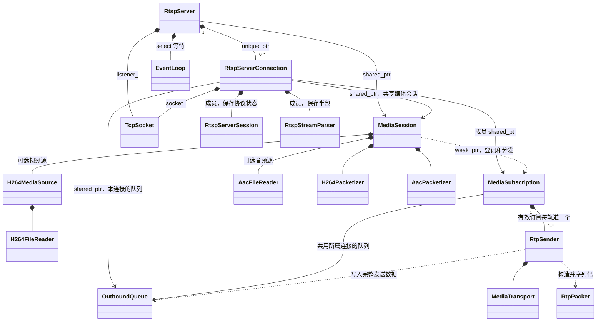
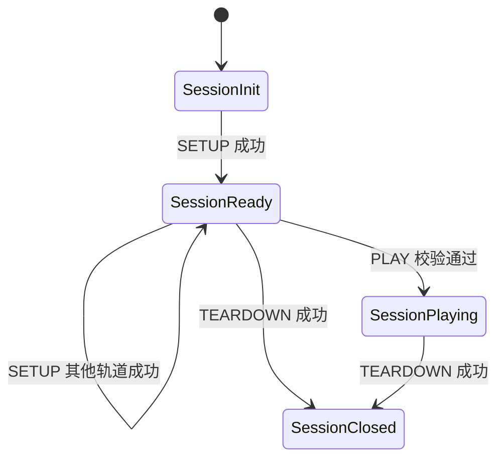
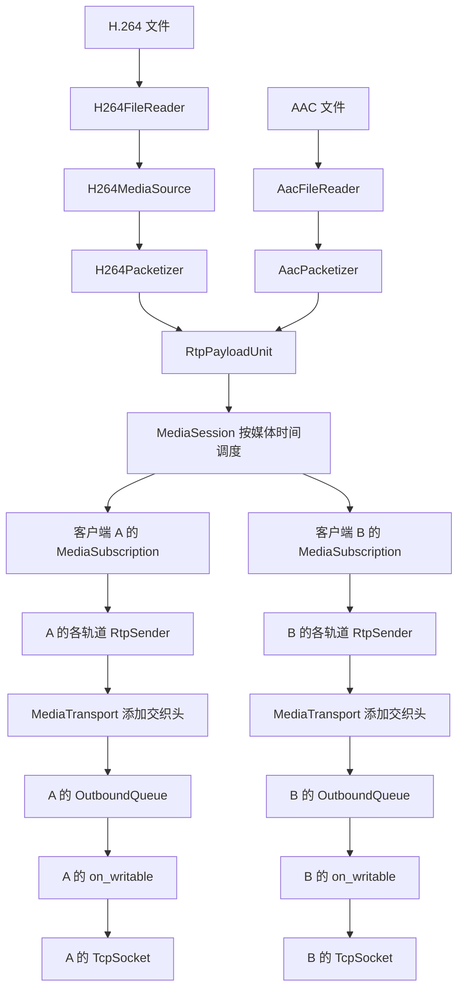
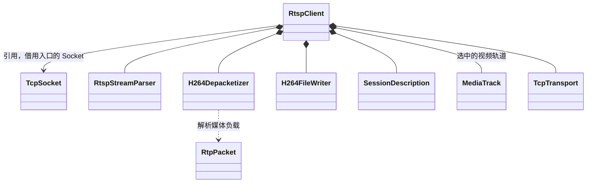

# RTSP 项目：类的职责与关系

本文依据当前 `src/` 中的代码整理，覆盖服务器、客户端、媒体处理、RTP 和网络模块。整理日期：2026-10-27。

阶段 6 已将服务器改为单线程事件循环，详见 [事件循环实现说明](event_loop_implementation.md)。

阶段 7 已补齐 TCP 基本 RTCP、保活和有限收尾，详见 [RTCP 与运行时实现说明](rtcp_runtime_implementation.md)。

项目的核心结构是：**`RtspServer` 管理连接，`RtspServerSession` 管理单个客户端的协议状态，`MediaSession` 统一生产媒体数据，再通过各客户端的 `MediaSubscription` 分发。**

## 1. 整体结构

当前项目主要通过组合、共享对象和函数调用组织代码，没有类继承体系。

| 模块 | 主要职责 | 代表类型 |
| --- | --- | --- |
| `app` | 解析命令行参数，创建并启动服务器或客户端 | 两个 `main()`，不是类 |
| `rtsp` | 控制协议、会话状态、连接协调、TCP 交织封装 | `RtspServer`、`RtspServerConnection`、`RtspServerSession`、`RtspClient` |
| `sdp` | 描述、生成和解析媒体轨道配置 | `SessionDescription`、`MediaTrack` |
| `media` | 读取媒体、共享调度、封包解包、保存文件 | `MediaSession`、`MediaSubscription`、两种 Packetizer |
| `rtp` | RTP 公共头处理、每客户端每轨道的发送状态 | `RtpPacket`、`RtpSender`、`RtpPayloadUnit` |
| `net` | Socket 操作、线程安全输出队列、Winsock 初始化 | `EventLoop`、`TcpSocket`、`OutboundQueue`、`WinsockRuntime` |

这些是职责分组，不代表严格的单向依赖：例如 `media` 中的订阅会使用 `RtpSender`，而 `RtpSender` 使用 `rtsp` 中的 `MediaTransport`。

## 2. 服务器核心类关系图

图中的 `*--` 表示独占持有或成员组合；`-->` 表示持有引用关系，具体所有权见标签；`..>` 表示调用、使用或弱引用。



阶段 6 将 `RtspServerSession`、`RtspStreamParser` 和订阅移为 `RtspServerConnection` 的成员，以便跨多次读写事件保存状态。

## 3. 先分清三个 Session / Subscription

| 类型 | 管理对象 | 生命周期与数量 | 核心问题 |
| --- | --- | --- | --- |
| `RtspServerSession` | 单个客户端的 RTSP 协议状态 | 每个连接持有一个成员对象 | 这个请求是否合法？当前能不能 PLAY？ |
| `MediaSession` | 一个资源的媒体数据、进度和调度期限 | 当前服务器创建一个，所有连接共享 | 现在该发送哪个轨道的哪一帧？ |
| `MediaSubscription` | 一个客户端对共享媒体的订阅 | PLAY 成功时建立，由对应连接持有 | 这个客户端订阅哪些轨道？从哪里开始接收？ |

三者的协作是：

> `RtspServerSession` 判断是否允许播放；`MediaSession` 决定共享媒体播放到哪里；`MediaSubscription` 将当前媒体转换为该客户端的 RTP 数据并入队。

## 4. 控制与连接相关的类

| 类 | 职责 | 主要方法 | 主要关系 |
| --- | --- | --- | --- |
| `RtspServer` | 监听、接受连接、回收连接、停止服务器 | `run()`、`stop()`、`reap_finished_connections()` | 创建一个共享 `MediaSession`，用 `unique_ptr` 管理多个连接 |
| `RtspServerConnection` | 协调一个客户端的协议处理、媒体订阅和网络发送 | `accept_from()`、`on_readable()`、`on_writable()`、`check_timeout()`、`close()` | 拥有客户端 Socket、输出队列和发送偏移，使用共享媒体会话 |
| `RtspServerSession` | 校验请求、生成响应、维护 RTSP 状态和轨道协商结果 | `handle()`、`state()`、`tracks()`、`has_channel()` | 保存 `SessionDescription` 和 `TrackState`；不操作 Socket |
| `RtspStreamParser` | 累积 TCP 字节，处理半包和粘包，拆分 RTSP 文本与交织帧 | `append()`、`next()`、`finish()` | 输出 `RtspStreamItem`，客户端和服务器都使用 |
| `RtspClient` | 执行 RTSP 客户端流程，接收 H.264 并保存文件 | `run()`、`exchange()`、`receive_media()`、`handle_interleaved()` | 借用外部 Socket，组合解析器、解包器和文件写入器 |

源码入口：

- [RtspServer](src/rtsp/rtsp_server.h)
- [RtspServerConnection](src/rtsp/rtsp_server_connection.h)
- [RtspServerSession](src/rtsp/rtsp_server_session.h)
- [RtspStreamParser](src/rtsp/rtsp_stream_parser.h)
- [RtspClient](src/rtsp/rtsp_client.h)

### 4.1 RtspServer：服务器总管理者

`server_main.cpp` 创建 `RtspServer` 并调用 `run()`。服务器构造时创建媒体会话，运行时通过监听 Socket 接受客户端；每接受一个客户端，就创建一个 `RtspServerConnection`，把同一个媒体会话交给它。

连接标记 Closed 后，服务器在事件分派结束时从容器中移除该连接。

### 4.2 RtspServerConnection：单连接的协调者

一个连接有自己的 Socket、输出队列、协议状态、解析缓冲和发送进度，所有连接都由同一个事件循环处理。

`on_readable()` 使用流解析器接收请求，再交给 `RtspServerSession::handle()` 校验。PLAY 成功时创建订阅，为已经 SETUP 的轨道建立 Sender，然后注册到共享媒体会话；TEARDOWN 时取消订阅并将响应入队。

该类连接了协议、媒体和网络三个部分，是阅读服务器调用流程的主要入口。

### 4.3 RtspServerSession：独立的协议状态机

主要状态变化如下：



OPTIONS 和 DESCRIBE 不推进这条状态链。错误请求不提交相应的状态变化。

PLAY 还需要媒体层接受订阅。因此连接先在协议会话的副本上处理请求，订阅成功后才提交副本；资源结束等情况会返回错误响应，保留原来的真实协议状态。

## 5. 媒体处理相关的类

| 类 | 职责 | 输入与输出 | 主要关系 |
| --- | --- | --- | --- |
| `MediaSession` | 管理共享进度，按媒体时间调度音视频并分发 | 媒体源 → 各订阅 | 持有源和封包器，弱引用登记订阅 |
| `MediaSubscription` | 管理单客户端的起播条件、媒体时间基准和轨道 Sender | `RtpPayloadUnit` → 客户端队列 | 每条订阅轨道独占一个 `RtpSender` |
| `H264MediaSource` | 包装 H.264 读取器，缓存 SPS/PPS，为缺少参数集的 IDR 补齐参数 | 文件读取结果 → `H264AccessUnit` | 内含 `H264FileReader`，提供视频 SDP 配置 |
| `H264FileReader` | 解析 Annex-B 文件，按 AUD 划分访问单元并提取 SPS/PPS | H.264 文件 → `H264AccessUnit` | 在内存中保存访问单元，维护读取游标 |
| `AacFileReader` | 解析 ADTS AAC-LC，检查配置，去掉 ADTS 头 | AAC 文件 → `AacAccessUnit` | 保存音频访问单元，提供音频 `MediaTrack` |
| `H264Packetizer` | 单 NALU 封装和 FU-A 分片 | `H264AccessUnit` → `RtpPayloadUnit` | 由事件循环的媒体 tick 调用 |
| `AacPacketizer` | 添加 MPEG4-GENERIC / AAC-hbr AU Header | `AacAccessUnit` → `RtpPayloadUnit` | 由事件循环的媒体 tick 调用 |
| `H264Depacketizer` | 单 NALU、FU-A、STAP-A 解包，检查分片连续性 | `RtpPacket` → 完整 NALU | 客户端持有，每个对象处理一路 H.264 轨道 |
| `H264FileWriter` | 添加四字节 Annex-B 起始码并写文件 | 完整 NALU → H.264 文件 | 客户端在解包后调用 |

源码入口：

- [MediaSession 与 MediaSubscription](src/media/media_session.h)
- [H264MediaSource](src/media/media_source.h)
- [H264FileReader](src/media/h264_file_reader.h)、[AacFileReader](src/media/aac_file_reader.h)
- [H264Packetizer](src/media/h264_packetizer.h)、[AacPacketizer](src/media/aac_packetizer.h)
- [H264Depacketizer](src/media/h264_depacketizer.h)、[H264FileWriter](src/media/h264_file_writer.h)

### 5.1 MediaSession：共享媒体的调度中心

`MediaSession` 由服务器事件循环调用 `tick(now)`。它为每条轨道预读一个访问单元，比较媒体时间，到期时投递给各个订阅；未到期则记录 `next_deadline()` 并返回，不阻塞等待。

视频和音频可以单独启用，也可以同时启用。一条轨道结束后，另一条仍可以继续；所有启用轨道都结束后，媒体会话统一结束。

没有有效订阅时，共享媒体进度暂停。后续订阅加入会继续使用保留进度；文件结束后，新的 PLAY 会被拒绝，当前实现需要重启服务器才能重新从头播放。

### 5.2 MediaSubscription：共享负载与独立客户端之间的桥梁

订阅中每条轨道都有独立的 `RtpSender`，但这些 Sender 共用所属连接的输出队列。

订阅包含视频时，会等待下一次 IDR 作为起点；只订阅音频时，从收到的当前音频访问单元开始。各轨道使用同一个媒体起点，再按自己的时钟频率换算 RTP 时间戳。

`MediaSession` 是 `MediaSubscription` 的友元，可以调用其私有的 `start()`、`deliver()` 和 `finish()`；连接通过 `add_track()`、`end()`、`cancel()`、`finished()` 和 `failed()` 管理订阅，并通过 `tick_rtcp()`、`prepare_rtcp()`、`on_sent()` 和 `receive_rtcp()` 管理报告与反馈。

### 5.3 Reader、Source 和 Packetizer 的分工

- Reader 负责媒体文件格式，两个读取器都会在打开时加载并验证样例文件，之后 `read()` 推进内存游标。
- `H264MediaSource` 在读取器之上提供播放所需的参数集处理和视频描述信息。
- Packetizer 只负责媒体负载格式，不添加 RTP 公共头，也不访问 Socket。

当前没有统一的 `MediaSource` 抽象基类：视频通过 `H264MediaSource` 接入，音频直接通过 `AacFileReader` 接入。

## 6. RTP、传输与网络相关的类

| 类 | 职责 | 主要关系 |
| --- | --- | --- |
| `RtpSender` | 维护一条客户端轨道的 PT、序号和 SSRC；为负载添加 RTP 头 | 使用 `MediaTransport` 添加交织头，将结果入队 |
| `MediaClock` | 将单调调度时间映射为 NTP，以轨道时钟计算 RTP 对应时间 | 由共享 MediaSession 持有，订阅生成 SR 时使用 |
| `MediaTransport` | 保存传输配置，为 RTP/RTCP 添加 TCP 交织帧头 | 内含 `TcpTransport`，当前只有 TCP interleaved 模式 |
| `OutboundQueue` | 每连接的线程安全有界 FIFO 队列；push 不等待空位 | 协议处理和媒体 tick 写入，连接 on_writable 消费 |
| `EventLoop` | 用 select 等待多个 Socket 可读/可写，支持超时返回 | 由 RtspServer 管理和分派事件 |
| `TcpSocket` | 封装 Windows TCP 阻塞与非阻塞接口 | 一个对象管理一个 Socket 句柄，禁止复制 |
| `WinsockRuntime` | 将 `WSAStartup` 和 `WSACleanup` 配对管理 | `socket_utils.cpp` 内部类，由函数内静态对象管理生命周期 |

源码入口：

- [RtpSender](src/rtp/rtp_sender.h)、[MediaTransport](src/rtsp/media_transport.h)
- [OutboundQueue](src/net/outbound_queue.h)、[TcpSocket](src/net/tcp_socket.h)
- [WinsockRuntime](src/net/socket_utils.cpp)

`RtpSender` 的处理顺序是：

```text
RtpPayloadUnit 中的某个负载
    → 构造 RtpPacket，填写序号、时间戳、SSRC、PT、Marker
    → serialize_rtp_packet() 生成 RTP 字节
    → MediaTransport::frame_rtp() 添加 TCP 交织头
    → OutboundQueue::push() 入队
```

因此，`RtpSender` 虽然名为 Sender，实际只生成数据并入队。服务器端实际在连接的 `on_writable()` 中调用非阻塞 `TcpSocket::send_some()`，并保存剩余发送偏移。

## 7. 类之间传递的数据结构

| 类型 | 内容 | 主要使用者 |
| --- | --- | --- |
| `RtspHeader` | 一个 RTSP 头字段的名称和值 | `RtspMessage` |
| `RtspMessage` | 请求或响应首行、头字段、消息体 | 解析器、协议会话、客户端 |
| `RtspStreamItem` | 一条 RTSP 消息，或一个交织帧的通道号与负载 | 流解析器和连接处理逻辑 |
| `SessionDescription` | 聚合 control 和轨道列表 | 媒体会话、协议会话、客户端 |
| `MediaTrack` | 轨道类型、编码、PT、时钟频率、通道数、control、fmtp | SDP 处理、轨道选择和 Sender 创建 |
| `TrackState` | 某条轨道是否 SETUP，以及协商的 `TcpTransport` | `RtspServerSession` |
| `TcpTransport` | RTP 和 RTCP 的 TCP 通道号 | SETUP 协商、`MediaTransport` |
| `H264AccessUnit` | 一组 NALU、关键帧标记、媒体时间和持续时间 | 视频读取器、媒体源、封包器 |
| `AacAccessUnit` | 不含 ADTS 头的 AAC、媒体时间和持续采样数 | 音频读取器、封包器 |
| `RtpPayloadUnit` | 一个访问单元生成的一组负载、媒体时间、时钟频率和关键帧标记 | Packetizer、媒体会话、订阅、Sender |
| `RtpPacket` | RTP 公共头字段、可选头与有效负载 | RTP 编解码、Sender、H.264 解包器 |
| `OutboundMessage` | 输出消息类型和完整待发送字节 | 输出队列、连接的可写处理 |
| `MediaSubscription::TrackSender` | 轨道索引、RtpSender、RTCP 时间映射、实际发送统计与 RR 反馈 | 订阅内部使用 |
| `RtcpPacket` / `RtcpReceptionReport` | SR、SDES、BYE 和 RR 基本字段 | RTCP 编解码、订阅、客户端 |
| `RuntimeOptions` | Session、RTCP、控制空闲、发送无进展和绝对收尾期限 | 服务器与连接 |

`RtpPayloadUnit` 和 `RtpPacket` 的区别是：前者只保存媒体负载，一组负载可生成多个包；后者表示带 RTP 头的一个包。

SDP、RTSP 消息和 RTP 包的解析与序列化，部分由普通函数完成，例如 `parse_sdp()`、`make_sdp()`、`parse_rtsp_message()`、`serialize_rtsp_message()`、`parse_rtp_packet()` 和 `serialize_rtp_packet()`，并不是独立的 Parser 类。

## 8. 一次播放如何连接各个类

### 8.1 控制流程

客户端依次执行 OPTIONS、DESCRIBE、SETUP、PLAY。多轨道客户端需要对希望接收的每条轨道分别 SETUP，然后对聚合资源发送 PLAY。

服务器处理 PLAY 的主要调用关系：

```text
TcpSocket::receive()
    ↓
RtspStreamParser::append() / next()
    ↓ 得到 RtspMessage
RtspServerSession 成员副本的 handle()
    ↓ 校验通过，生成 PLAY 响应
RtspServerConnection 创建 MediaSubscription
    ↓ 为已经 SETUP 的轨道调用 add_track()
每轨道创建独立 RtpSender
    ↓
MediaSession::subscribe()
    ↓ 登记订阅，先将 PLAY 响应入队
提交协议状态，允许后续媒体进入同一个队列
```

PLAY 响应先入队，媒体随后入队，因此客户端先看到成功响应，再看到该次播放的数据。

源码：[RtspServerConnection::on_readable() / handle_item()](src/rtsp/rtsp_server_connection.cpp)、[MediaSession::subscribe()](src/media/media_session.cpp)。

### 8.2 服务器媒体数据流



共享的是文件读取、播放进度和负载封装结果。每个客户端仍要单独构造 RTP 包和输出字节；这里并不意味着整条发送链路零拷贝。

### 8.3 客户端类关系与数据流



```text
TcpSocket::receive()
    → RtspStreamParser
    → RtspStreamItem
        ├─ RTSP 响应：校验状态码、CSeq 和 Session
        └─ 交织帧：按协商通道分流
             ├─ RTCP：解析并校验 SR 的 SSRC
             └─ RTP：parse_rtp_packet()
                       → H264Depacketizer
                       → 完整 NALU
                       → H264FileWriter
                       → received.h264
```

当前自带客户端只选择 H.264 轨道。接收到指定数量的访问单元后会发送 TEARDOWN；默认数量为零时接收到媒体 EOF 后结束。

### 8.4 TEARDOWN 和 EOF

TEARDOWN 时，连接先调用订阅的 `end()`，停止新的 RTP 并排入最终 SR/SDES/BYE，然后将 TEARDOWN 响应放入队列，最后关闭队列。已经入队的数据仍可能先于响应发出。异常关闭使用 `cancel()`，不保证发送 BYE。

正常媒体 EOF 时，媒体会话结束订阅，排入最终 RTCP 后关闭队列；连接进入 Draining，由事件循环在绝对期限内发送剩余消息后关闭发送方向和 Socket。客户端检查是否还有半条 TCP 消息、未完成的 FU-A 或未结束的访问单元。

## 9. 所有权与生命周期

| 关系 | 代码表达 | 意义 |
| --- | --- | --- |
| 服务器 → 连接 | `vector<unique_ptr<RtspServerConnection>>` | 服务器独占管理连接，统一回收 |
| 服务器、连接 → 媒体会话 | `shared_ptr<MediaSession>` | 所有连接共享一个资源和进度 |
| 连接 → 订阅 | 成员 `shared_ptr<MediaSubscription>` | 连接管理订阅的生命周期 |
| 媒体会话 → 订阅 | `vector<weak_ptr<MediaSubscription>>` | 登记订阅而不长期延长其生命周期；分发时临时获取强引用 |
| 连接、订阅 → 队列 | `shared_ptr<OutboundQueue>` | 协议和媒体生产者使用同一个客户端队列 |
| 订阅 → 轨道 Sender | `unique_ptr<RtpSender>` | Sender 的 RTP 状态归对应订阅轨道独有 |
| 客户端 → Socket | `TcpSocket&` | 借用入口程序的 Socket，入口负责其生命周期 |

服务器和连接都持有 `MediaSession`，但 `MediaSession` 对订阅使用弱引用，因此不会形成彼此强引用的闭环。

## 10. 事件循环与队列关系

```text
RtspServer::run()：唯一服务器运行线程
    ├─ MediaSession::tick(now)：媒体到期则生成并分发
    ├─ EventLoop::wait(timeout)：等待网络事件或媒体期限
    ├─ 监听可读：try_accept 接受新连接
    ├─ 连接可读：on_readable 处理 RTSP 和订阅
    └─ 连接可写：on_writable 继续发送，保存未完成的偏移
```

RTSP 响应和媒体都进入同一连接队列，按照 FIFO 发送。每次收发最多 64 KiB，媒体每次最多推进 32 AU，accept 每轮最多 16 次，保证多个连接能轮流处理。

`take_for_send()` 将消息交给连接但继续计入队列额度；整条消息发送完成后 `complete_send()` 才释放额度。队列满时关闭对应的失败订阅和连接，其他客户端继续播放。

TEARDOWN、正常 EOF、接收半关闭、Session 到期和服务器停止进入 Draining，默认在 2 秒内排空后关闭；错误、队列溢出或发送连续 2 秒无进展直接关闭。SETUP 前空闲 60 秒回收；SETUP 后要求有效 Session 请求或匹配的 RTCP RR 续期，默认期限 60 秒。跨线程停止只调用服务器 stop，由运行线程实际清理 Socket。

## 11. 当前实现的边界

- 当前服务器对应固定的 `/live` 资源，所有连接共享播放进度；尚无每客户端独立点播进度。
- 当前仅实现 TCP interleaved；`MediaTransport` 还没有 UDP 实现。
- 服务器支持 H.264、AAC 或双轨道；自带客户端只接收保存 H.264，没有 `AacDepacketizer`。
- 已实现 TCP 基本 RTCP SR/SDES/BYE、RR 反馈和 Session 保活；固定周期报告暂不包含完整 RTCP 带宽分配与随机调度。
- H.264 时间按固定 25 fps、解码顺序生成简化值，不解析真实 PTS/DTS；长期音视频同步仍需后续完善。
- 当前没有 RTSP PAUSE 方法；无订阅时停止推进是共享媒体层的行为。
- 中途加入的视频订阅等待下一次 IDR，并从该处接收，不补发前面的内容。

## 12. 推荐阅读顺序

先从服务器完整调用链入手：

```text
server_main.cpp
    → RtspServer::run()
    → EventLoop::wait()
    → RtspServerConnection::on_readable() / handle_item()
    → RtspServerSession::handle()
    → MediaSession::subscribe() / tick()
    → MediaSubscription::deliver()
    → RtpSender::send_payloads()
    → MediaTransport::frame_rtp()
    → OutboundQueue
    → RtspServerConnection::on_writable()
```

随后查看媒体格式和客户端：

```text
H264AccessUnit / AacAccessUnit / RtpPayloadUnit
    → H264FileReader / AacFileReader
    → H264MediaSource
    → H264Packetizer / AacPacketizer
    → RtspClient::run()
    → RtspClient::handle_interleaved()
    → H264Depacketizer
    → H264FileWriter
```

新增 `event_loop_tests.cpp` 验证非阻塞、部分发送、半关闭排空、媒体期限、慢客户端隔离和服务器停止。配套测试可辅助理解边界：`session_tests.cpp` 验证协议状态，`media_session_tests.cpp` 验证共享进度和订阅，`multitrack_tests.cpp` 验证多轨道，`outbound_tests.cpp` 验证队列与 Sender。
